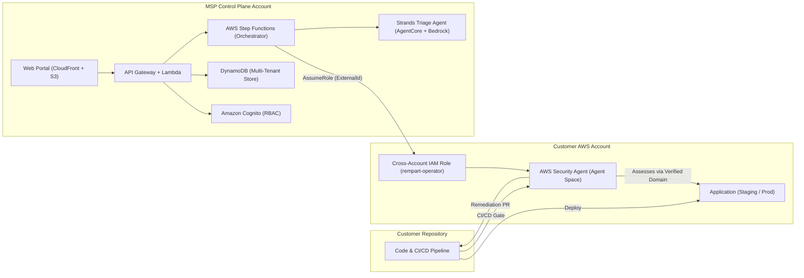

# Rempart 🛡️

**Continuous Penetration Testing as a Managed Subscription**  
*AWS MSP AI Hackathon — Track 2: Deliver AI-Driven Outcomes for Customers*  
*Target Special Award: Best AWS Frontier Agents Application (AWS Security Agent)*

[](.github/workflows/ci-budget.yml)
[](backend/)
[](iac/control-plane/)
[](docs/HLD.md)

---

## 📌 Executive Pitch & Value Proposition

Traditional penetration testing happens once a year, producing an obsolete PDF weeks after execution while software development teams ship code daily.

**Rempart** enables Managed Service Providers (MSPs) to deliver **continuous application penetration testing as a recurring monthly subscription**:
- **Continuous CI/CD Gating**: At every release, AWS Security Agent automatically tests deployed increments in staging, blocking promotion if P1/P2 vulnerabilities are uncovered.
- **Contextual AI Triage**: A Strands triage agent running on AgentCore Runtime & Bedrock scores findings against business exposure, applying deterministic guardrails to prevent hallucinated severity or unlawful dismissals.
- **Closed-Loop Remediation**: Security Agent generates automated remediation pull requests; post-merge retests cryptographically prove vulnerability closure before closing tickets.
- **Multi-Tenant Fleet Governance**: Central serverless control plane managing distributed customer accounts, enforcing signed test mandates, verified domains, and task-hour budget caps ($50/hour rate).

Detailed architectural specifications: [High-Level Design (HLD)](docs/HLD.md) | [French Functional Specification (Cahier des charges)](docs/cahier-des-charges-tests-intrusion-continu.md).

---

## 🏗️ Architecture

AWS Security Agent operates directly inside each customer account to satisfy hard AWS quotas (20 integrations per region, 5 concurrent tests) and maintain strict billing/data isolation. Rempart orchestrates assessments remotely via cross-account IAM roles with `sts:ExternalId`.



---

## 🗂️ Repository Layout

```
├── backend/
│   ├── pyproject.toml              # Ruff and Pytest configuration
│   ├── rempart/
│   │   ├── common/                 # Models, deterministic priority matrix, budget, authz, store
│   │   ├── api/                    # HTTP Lambda handlers (Cognito JWT validation, tenant isolation)
│   │   ├── orchestrator/           # Step Functions tasks, Security Agent client, GitHub ticketing
│   │   ├── triage/                 # Strands agent on AgentCore Runtime, guardrails, tools
│   │   └── reports/                # Deterministic KPI calculations, HTML/PDF monthly report
│   └── tests/                      # Fast, zero-network test suite using test doubles (fakes.py)
├── iac/
│   ├── control-plane/              # AWS CDK Python app for MSP infrastructure
│   └── client-account/             # rempart-client.template.yaml for customer onboarding
├── portal/                         # Vite + React 18 + TypeScript web dashboard (English)
├── demo/
│   ├── app-a/                      # ShopLite (seeded IDOR vulnerability)
│   ├── app-b/                      # BookWorm (seeded SQLi / unauthenticated admin)
│   └── gate/                       # Reusable GitHub Actions CI/CD gate workflow
└── docs/
    ├── HLD.md                      # High-Level Design for hackathon submission
    ├── acceptance.md               # Acceptance test suite & scenario matrix (R1–R12)
    └── cahier-des-charges-...md    # Detailed functional specification
```

---

## 🚀 Quickstart & Development

Rempart enforces clean modular boundaries: all backend modules depend solely on `rempart.common`. Tests execute purely in memory without AWS or network dependencies.

### 1. Backend Setup & Pytest
```bash
# Set up Python 3.12 virtual environment
python3 -m venv .venv
source .venv/bin/activate

# Install backend dependencies
cd backend
pip install -e ".[dev]"

# Run complete acceptance & unit test suite
python -m pytest tests -v
```

### 2. Portal Frontend Setup
```bash
cd portal
npm install
npm run build     # Validates TypeScript compilation and bundles app
npm test          # Runs frontend Vitest suite
```

---

## ☁️ Deployment Overview

### Step 1: Deploy MSP Control Plane (AWS CDK)
The control plane deploys DynamoDB tables, Cognito user pools, API Gateway, Step Functions workflows, and CloudFront distributions:
```bash
cd iac/control-plane
pip install -r requirements.txt
cdk bootstrap aws://<MSP_ACCOUNT_ID>/<REGION>
cdk deploy --all
```

### Step 2: Onboard Customer Account (Single CloudFormation Template)
Customer provisions cross-account trust in their AWS account using `iac/client-account/rempart-client.template.yaml`:
```bash
aws cloudformation deploy \
  --template-file iac/client-account/rempart-client.template.yaml \
  --stack-name rempart-client-agent \
  --capabilities CAPABILITY_NAMED_IAM \
  --parameter-overrides \
      MspAccountId="<MSP_ACCOUNT_ID>" \
      MspOrchestratorRoleName="rempart-orchestrator" \
      ExternalId="<TENANT_UNIQUE_UUID>" \
      GitHubOrg="<CUSTOMER_GITHUB_ORG>" \
      GitHubRepo="<CUSTOMER_GITHUB_REPO>"
```

---

## 🧪 Demo Instructions for Judges

A live deployment of Rempart is maintained for hackathon evaluators with pre-provisioned demo accounts and sample workloads.

### Accessing the Web Portal
- **Demo URL**: `https://demo.rempart.security` *(see submission details)*
- **Demo Username**: `judge@demo.rempart.security`
- **Demo Password**: *(provided in private submission notes)*
- **Role**: `demo` (read-only access to tenant `demo-tenant`, with rate-limited on-demand pentest execution).

### Walk-Through Scenario:
1. **Fleet Dashboard**: Review multi-tenant fleet metrics (Release-to-Result latency, blocked staging releases, MTTR by priority P1–P4).
2. **Seeded Vulnerability (ShopLite)**: Inspect open finding `f-shop-001` (IDOR on `/orders/<id>`). Note how the Strands agent generated a plain-language summary and how deterministic guardrails assigned priority `P1` (7-day SLA).
3. **Closed-Loop Verification**: Review run history for `ShopLite` showing:
   - Initial detection at staging gate and promotion freeze.
   - Code remediation PR generated by AWS Security Agent.
   - Automated retest run confirming resolution and granting audit closure proof.
4. **Task-Hour Budget**: Inspect the budget monitor showing task-hour consumption against the monthly cap ($50.00/hour rate) with automated cutoff thresholds.

---

## ⚡ Governance & Continuous Integration

This repository implements rigorous delivery and governance standards:
- **5-Minute CI Budget**: Every pull request executes native tests within a strict 5-minute timeout window (`.github/workflows/ci-budget.yml`).
- **Deterministic AI (ENF-IA-01)**: All metrics, task-hour financials, and SLA due dates are calculated by Python algorithms. Language models never calculate numeric data.
- **Safety Guardrail (ENF-IA-02)**: Critical and High severity findings proposed as false positives are routed to human analysts (`needs_human_validation=True`).
- **Code Limits**: Strict code cleanliness rules enforced across modules (files < 500 lines, functions < 50 lines, zero duplication).

---

## 🏁 Hackathon Submission

AWS MSP AI Hackathon — Track 2, *Deliver AI-Driven Outcomes for Customers*.
Submission deadline: **Friday 11 December 2026, 12:00 PT**.

- [Devpost submission text](docs/devpost-submission.md) — ready to paste into the form
- [Submission checklist](docs/submission-checklist.md) — official § 18.1 items, honest statuses and remaining blockers
- [Test instructions for judges](docs/judging-test-instructions.md) — 10-minute guided tour, demo credentials, fallback path
- [Video script](docs/video-script.md) — 3 minutes, timed shot by shot (recording is done by the team)
- [AWS Continuum API verification](docs/api-verification.md) — action-by-action check against the official API reference, and the pricing trap we avoided

---

## 📚 References & Resources

- [High-Level Design (HLD)](docs/HLD.md)
- [Acceptance Test Matrix (R1–R12)](docs/acceptance.md)
- [French Specifications Document (Cahier des charges)](docs/cahier-des-charges-tests-intrusion-continu.md)
- [Code Architecture Contract (CONTRACT.md)](CONTRACT.md)
