# Rempart 🛡️

**Continuous Penetration Testing as a Managed Subscription**  
*AWS MSP AI Hackathon — Track 2: Deliver AI-Driven Outcomes for Customers*  
*Target Special Award: Best AWS Frontier Agents Application (AWS Security Agent)*

[](.github/workflows/ci-budget.yml)
[](backend/)
[](iac/control-plane/)
[](docs/HLD.md)

---

## 📌 Executive Pitch & Value Proposition

Traditional penetration testing happens once a year, producing an obsolete PDF weeks after execution while software development teams ship code daily.

**Rempart** enables Managed Service Providers (MSPs) to deliver **continuous application penetration testing as a recurring monthly subscription**:
- **Continuous CI/CD Gating**: At every release, AWS Security Agent automatically tests deployed increments in staging, blocking promotion if P1/P2 vulnerabilities are uncovered.
- **Contextual AI Triage**: A Strands triage agent running on AgentCore Runtime & Bedrock scores findings against business exposure, applying deterministic guardrails to prevent hallucinated severity or unlawful dismissals.
- **Closed-Loop Remediation**: Security Agent generates automated remediation pull requests; post-merge retests cryptographically prove vulnerability closure before closing tickets.
- **Multi-Tenant Fleet Governance**: Central serverless control plane managing distributed customer accounts, enforcing signed test mandates, verified domains, and task-hour budget caps ($50/hour rate).

Detailed architectural specifications: [High-Level Design (HLD)](docs/HLD.md) | [French Functional Specification (Cahier des charges)](docs/cahier-des-charges-tests-intrusion-continu.md).

---

## 🏗️ Architecture

AWS Security Agent operates directly inside each customer account to satisfy hard AWS quotas (20 integrations per region, 5 concurrent tests) and maintain strict billing/data isolation. Rempart orchestrates assessments remotely via cross-account IAM roles with `sts:ExternalId`.

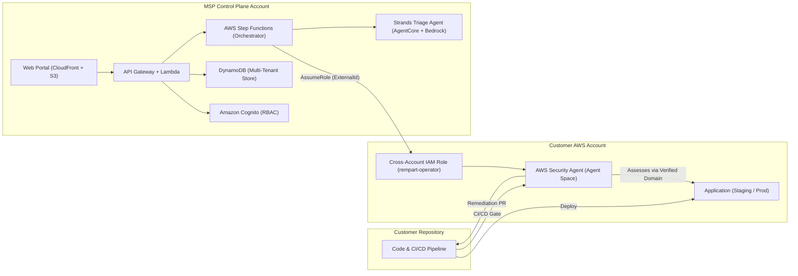

---

## 📸 Screenshots

All screenshots are taken from the **local demo** (frozen dataset, no AWS
account, no cost) — regenerate them at any time with
`./scripts/capture_screenshots.sh`.

| Fleet (MSP view) | Triage queue |
|---|---|
| 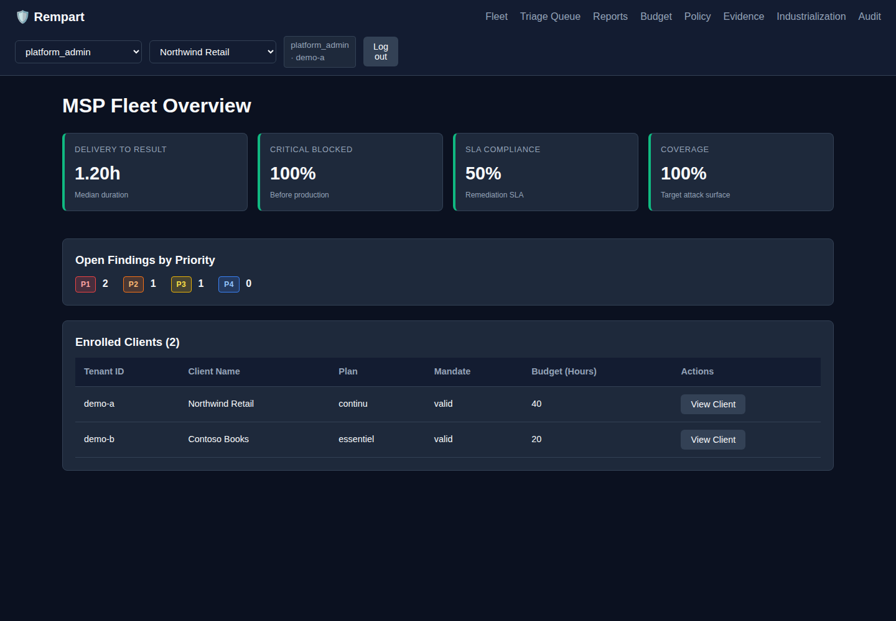 | 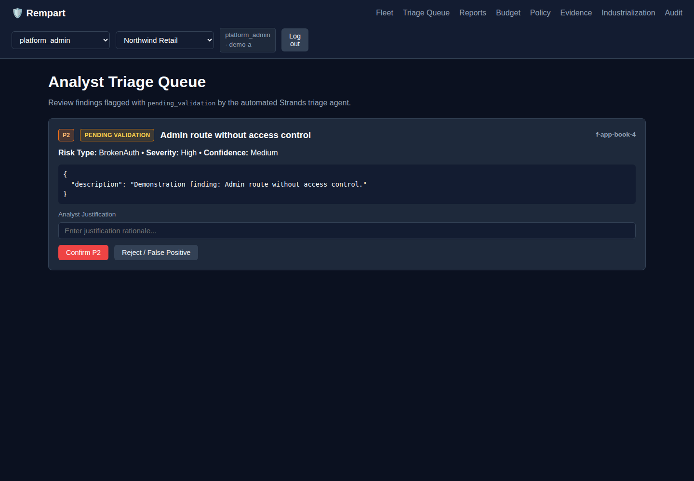 |

| Finding detail | Budget & forecast |
|---|---|
| 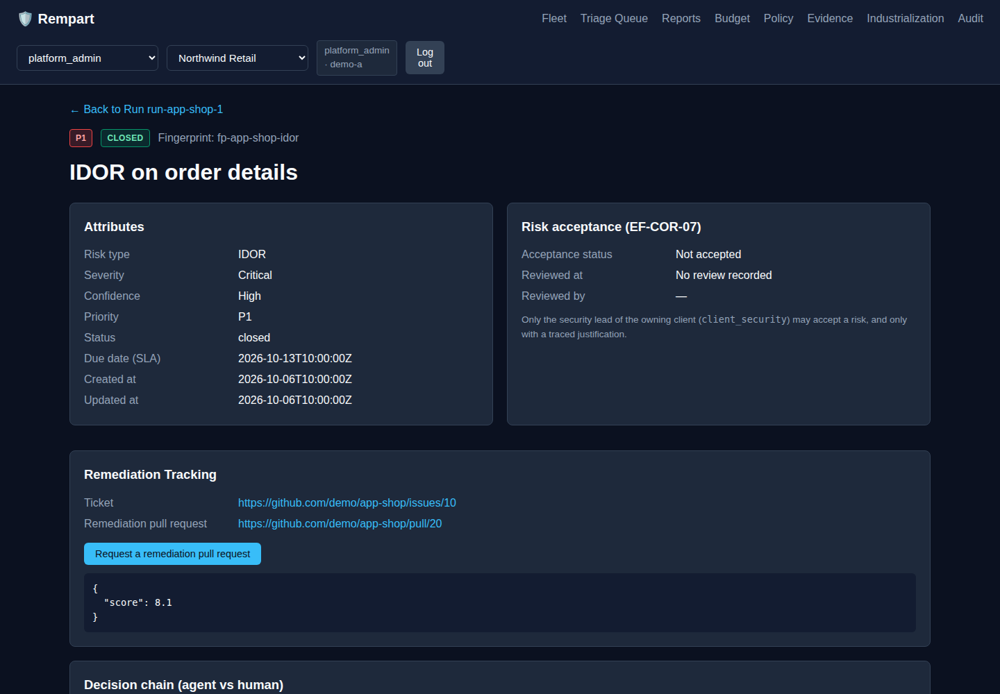 | 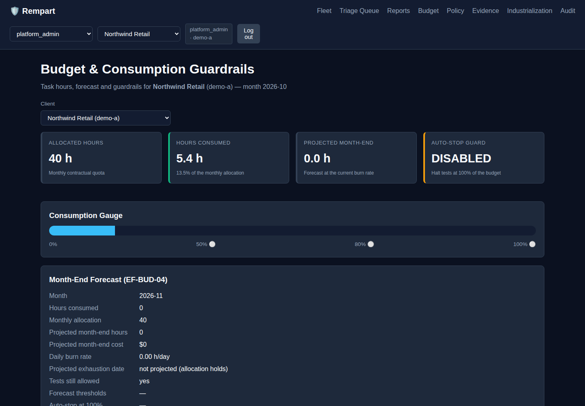 |

| Evidence dossier (scellé, empreinte recalculable) | Industrialization |
|---|---|
| 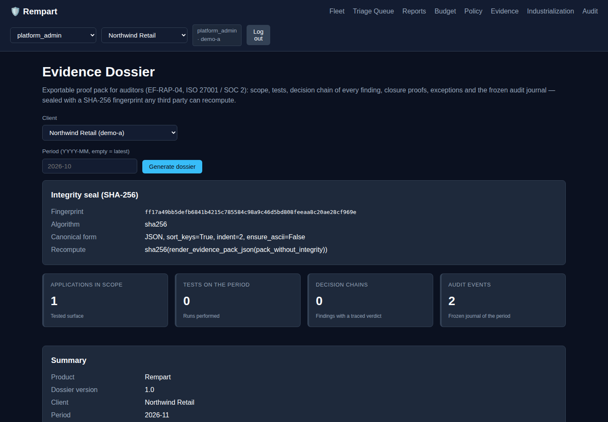 | 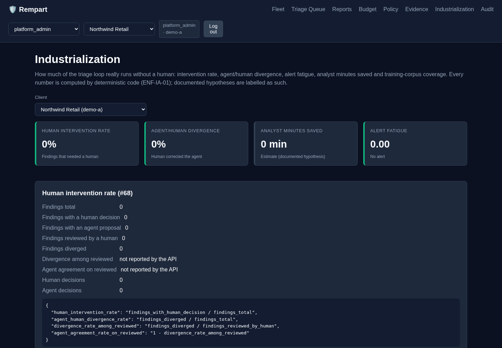 |

| Audit journal | Contract correction policy |
|---|---|
| 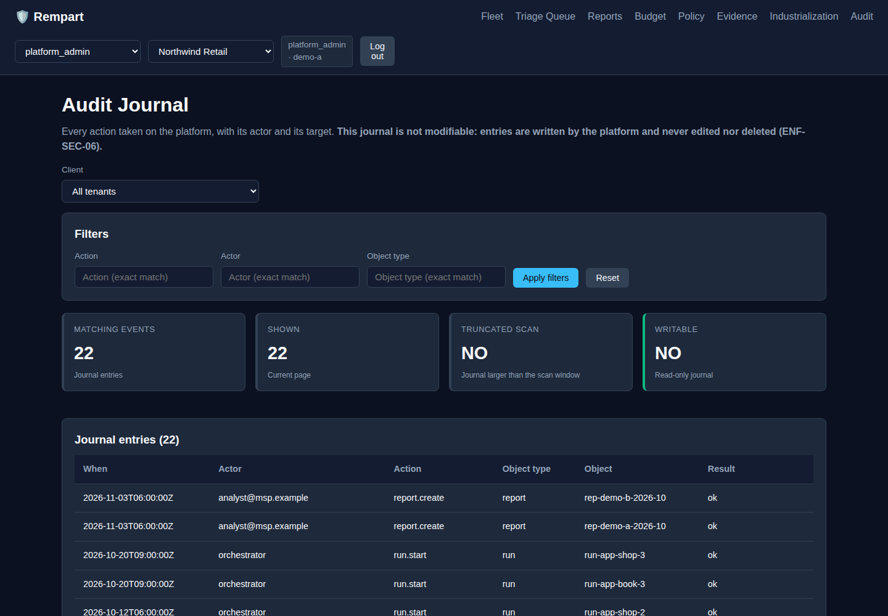 | 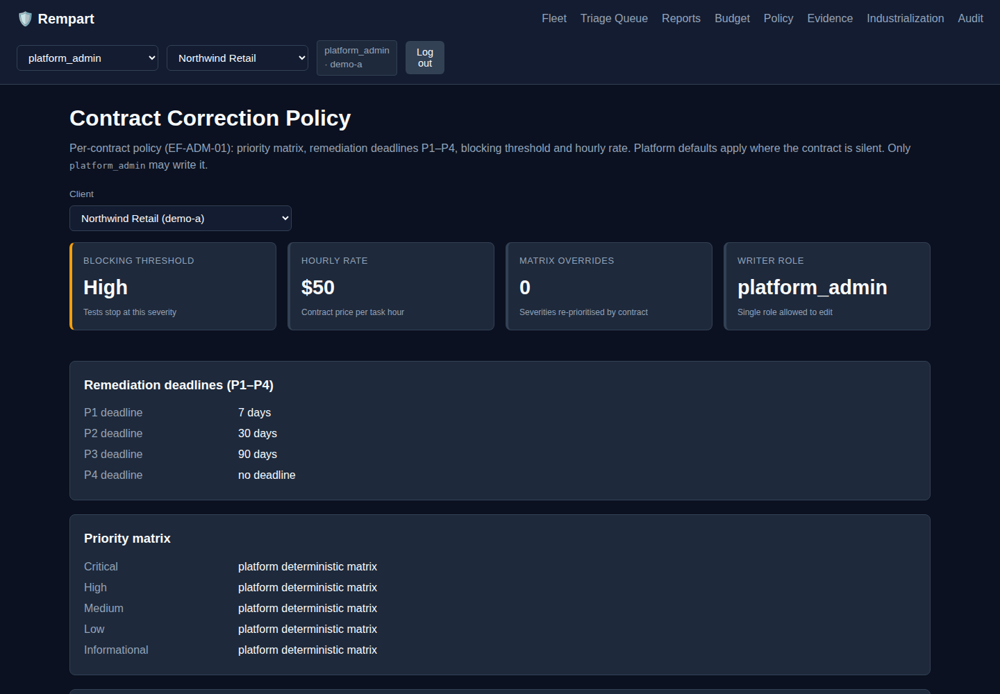 |

<details>
<summary>Every other screen (tenant, application, run, reports, login)</summary>

| Screen | Image |
|---|---|
| Tenant | 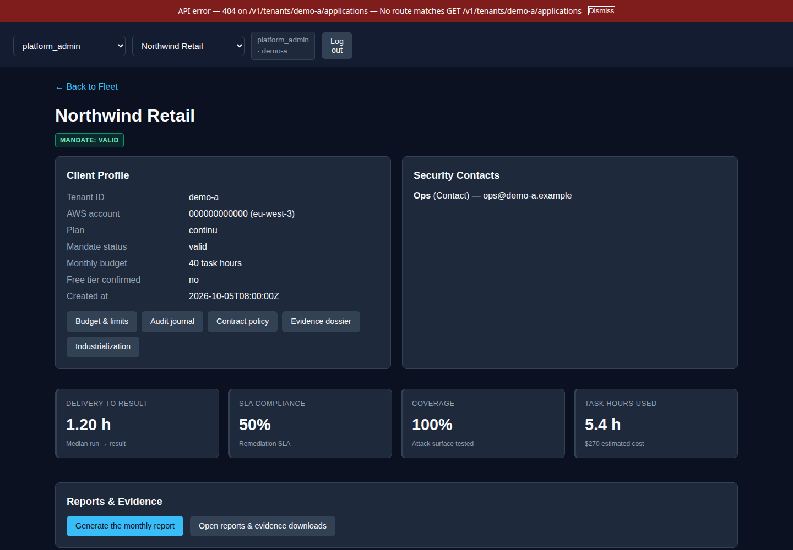 |
| Application | 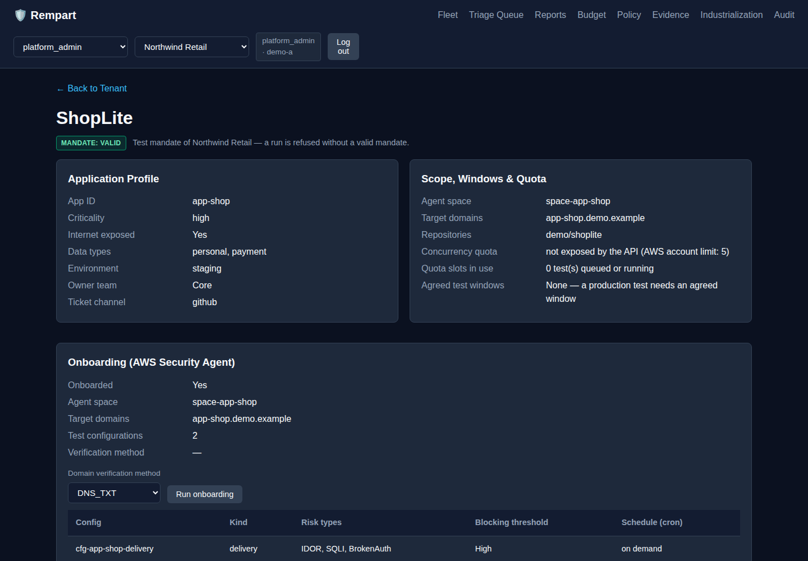 |
| Run (pentest job) | 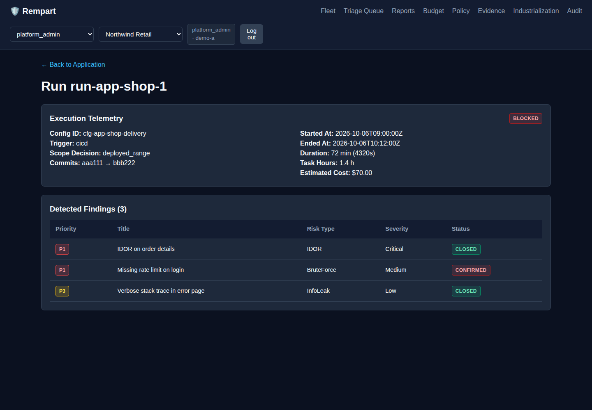 |
| Monthly reports | 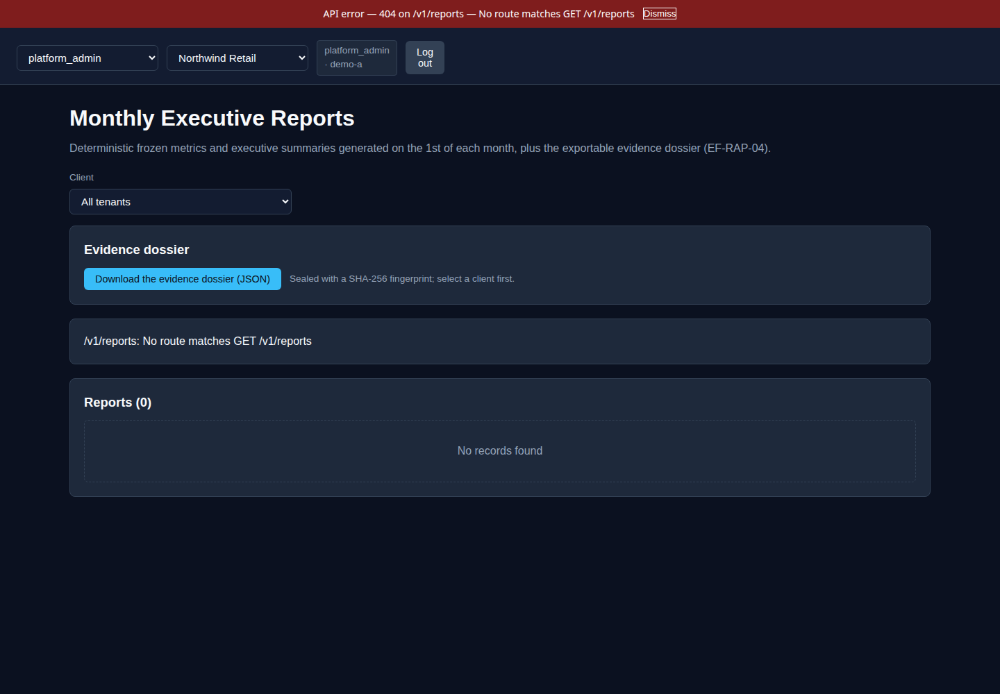 |
| Login / demo mode | 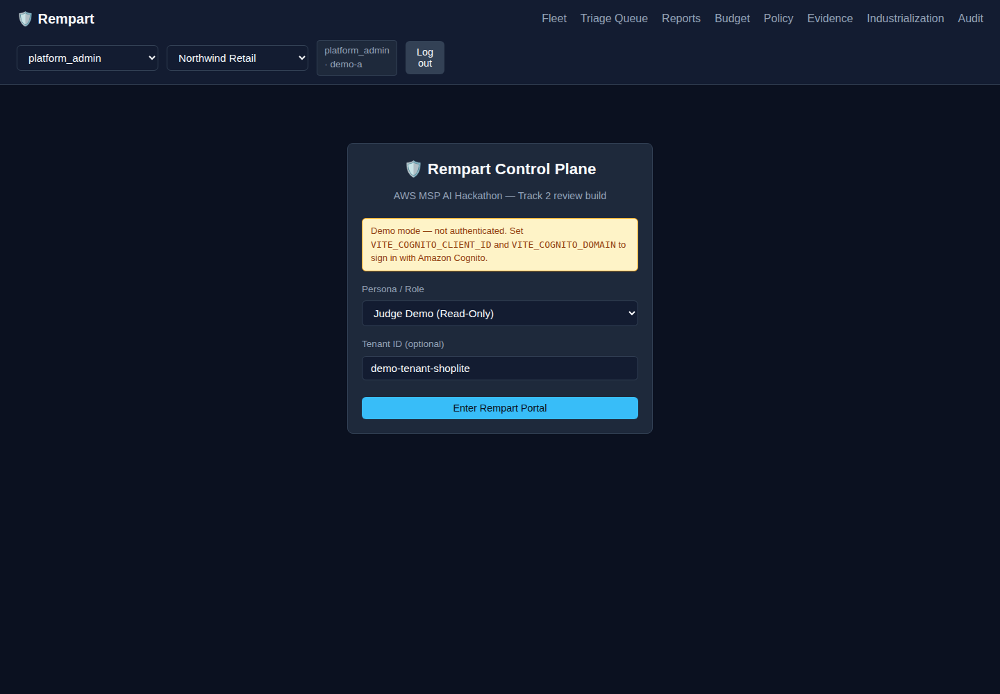 |

</details>

---

## 🗂️ Repository Layout

```
├── backend/
│   ├── pyproject.toml              # Ruff and Pytest configuration
│   ├── rempart/
│   │   ├── common/                 # Models, deterministic priority matrix, budget, authz, store
│   │   ├── api/                    # HTTP Lambda handlers (Cognito JWT validation, tenant isolation)
│   │   ├── orchestrator/           # Step Functions tasks, Security Agent client, GitHub ticketing
│   │   ├── triage/                 # Strands agent on AgentCore Runtime, guardrails, tools
│   │   └── reports/                # Deterministic KPI calculations, HTML/PDF monthly report
│   └── tests/                      # Fast, zero-network test suite using test doubles (fakes.py)
├── iac/
│   ├── control-plane/              # AWS CDK Python app for MSP infrastructure
│   └── client-account/             # rempart-client.template.yaml for customer onboarding
├── portal/                         # Vite + React 18 + TypeScript web dashboard (English)
├── demo/
│   ├── app-a/                      # ShopLite (seeded IDOR vulnerability)
│   ├── app-b/                      # BookWorm (seeded SQLi / unauthenticated admin)
│   └── gate/                       # Reusable GitHub Actions CI/CD gate workflow
└── docs/
    ├── HLD.md                      # High-Level Design for hackathon submission
    ├── acceptance.md               # Acceptance test suite & scenario matrix (R1–R12)
    └── cahier-des-charges-...md    # Detailed functional specification
```

---

## 🚀 Quickstart & Development

Rempart enforces clean modular boundaries: all backend modules depend solely on `rempart.common`. Tests execute purely in memory without AWS or network dependencies.

### 1. Backend Setup & Pytest
```bash
# Set up Python 3.12 virtual environment
python3 -m venv .venv
source .venv/bin/activate

# Install backend dependencies
cd backend
pip install -e ".[dev]"

# Run complete acceptance & unit test suite
python -m pytest tests -v
```

### 2. Portal Frontend Setup
```bash
cd portal
npm install
npm run build     # Validates TypeScript compilation and bundles app
npm test          # Runs frontend Vitest suite
```

---

## ☁️ Deployment Overview

### Step 1: Deploy MSP Control Plane (AWS CDK)
The control plane deploys DynamoDB tables, Cognito user pools, API Gateway, Step Functions workflows, and CloudFront distributions:
```bash
cd iac/control-plane
pip install -r requirements.txt
cdk bootstrap aws://<MSP_ACCOUNT_ID>/<REGION>
cdk deploy --all
```

### Step 2: Onboard Customer Account (Single CloudFormation Template)
Customer provisions cross-account trust in their AWS account using `iac/client-account/rempart-client.template.yaml`:
```bash
aws cloudformation deploy \
  --template-file iac/client-account/rempart-client.template.yaml \
  --stack-name rempart-client-agent \
  --capabilities CAPABILITY_NAMED_IAM \
  --parameter-overrides \
      MspAccountId="<MSP_ACCOUNT_ID>" \
      MspOrchestratorRoleName="rempart-orchestrator" \
      ExternalId="<TENANT_UNIQUE_UUID>" \
      GitHubOrg="<CUSTOMER_GITHUB_ORG>" \
      GitHubRepo="<CUSTOMER_GITHUB_REPO>"
```

---

## 🧪 Demo Instructions for Judges

### Option A — run it locally, no AWS account, zero cost (works today)

```bash
git clone git@github.com:Tradoooo/rempart.git && cd rempart
python3 -m venv .venv && .venv/bin/pip install -r backend/requirements-ci.txt
.venv/bin/python scripts/serve_local.py            # API + frozen dataset on :8000
cd portal && npm ci && npm run dev:local           # portal pointed at the local API
```

The local server serves the frozen dataset (`demo/seed/demo-dataset.json`:
2 customers, 2 applications, 6 runs, 6 findings across the whole lifecycle,
10 analyst decisions, budgets, 2 monthly reports, **22 audit events, 2 sealed
evidence dossiers (SHA-256 fingerprint a third party can recompute),
industrialization metrics, a budget forecast and the correction policy**) through
the **real** API handlers and the **real** authorisation layer — so tenant isolation is
enforced for real: a `client_security` token from tenant A gets `403` on every
tenant-B route. No AWS call is made, so nothing is billed.

### Coût de la démo : 0 €

Les deux options ci-dessous ne facturent **rien** : aucun compte AWS, aucun
appel sortant, aucune donnée client sur une URL publique. Ce n'est pas une
promesse mais un **test** : il coupe toute connexion réseau et vérifie que la
démo répond quand même
(`backend/tests/scripts/test_serve_local.py::test_la_demo_locale_ne_tente_aucun_appel_reseau`).

Le déploiement AWS complet (Cognito, DynamoDB, Step Functions, Security Agent)
est **optionnel** : il démontre le produit branché, pas la démo.

### Option B — public URL, live now

**https://tradoooo.github.io/rempart/**

Published on GitHub Pages from the `gh-pages` branch by
`.github/workflows/deploy-pages.yml`. It runs in **offline demo mode**: the data
is the frozen dataset, the same one served by `scripts/serve_local.py`. No
backend, no AWS account, no cost, and no real customer data on a public URL —
the portal says so with an "OFFLINE DEMO MODE" banner.

The full AWS-backed deployment (Cognito, DynamoDB, Step Functions, real
Continuum calls) still needs credentials and a verified domain; tracked in
[`docs/submission-checklist.md`](docs/submission-checklist.md).

- **Portal URL**: `https://tradoooo.github.io/rempart/`
- **Judge credentials**: `JUDGE_USER` / `JUDGE_PASSWORD`, role `demo`
  (read-only, banner "Judge demo — read-only", one on-demand test per day on
  the minimal scope)

### Walk-through (same in both options)

1. **Fleet** — multi-tenant metrics: delivery-to-result latency, P1/P2 blocked
   before production, mean time to remediate by priority, coverage.
2. **Finding** — the seeded IDOR on `/orders/{id}`: the Strands agent's
   plain-language summary, priority `P1` from the deterministic matrix, 7-day
   deadline, and the `pending_validation` state that proves the model cannot
   settle a Critical finding alone.
3. **Closed loop** — the remediation pull request requested from
   **AWS Continuum** (formerly "AWS Security Agent"), then the retest that
   closes the finding with the retest job id as proof.
4. **Budget** — task-hour consumption against the monthly cap (50 $/task-hour),
   alerts at 50/80/100 % and the auto-stop switch.
5. **Reports** — the monthly report (HTML + PDF) whose numbers are identical to
   the dashboard, because both are computed by the same deterministic code.

---

## ⚡ Governance & Continuous Integration

This repository implements rigorous delivery and governance standards:
- **5-Minute CI Budget**: every job declares `timeout-minutes: 5`, and `ci-budget` *fails the build* if any job declares more. Measured: backend ~1 m, IaC ~1 m, demo 35 s, portal 22 s.
- **Deterministic AI (ENF-IA-01)**: all metrics, task-hour costs and SLA due dates are computed by Python. The model never computes a number — and after the triage agent answers, the priority is **recomputed by the matrix**, which wins on divergence.
- **Safety Guardrail (ENF-IA-02)**: a Critical or High finding can never be dismissed by the model; it always waits for a human decision.
- **Prompt-injection resistance (ENF-IA-03)**: finding content is passed as delimited data (`<finding>…</finding>`) and the system prompt forbids following any instruction inside it.
- **Zero-cost by default**: `REMPART_FREE_TIER_ONLY=1` refuses any real test until free-tier eligibility is confirmed per tenant, and `REMPART_MAX_TASK_HOURS_PER_TEST=5` stops a runaway test. See the [free-tier runbook](docs/free-tier-runbook.md).
- **13-month retention, enforced**: every write stamps `expire_at`, so DynamoDB TTL actually purges findings (ENF-DATA-01). Configuring TTL without writing the attribute would purge nothing.
- **Auditability**: an immutable audit journal (read-only API, writes refused) plus an exportable, SHA-256-sealed [evidence pack](docs/) for ISO 27001 / SOC 2 reviews.
- **Contract-tested infrastructure**: a test asserts every Lambda handler declared in CDK exists with an `(event, context)` signature — this caught a placeholder that would have deployed empty functions.
- **Code Limits**: files < 500 lines, functions < 50 lines, zero duplication — verified by an AST scan, not by intention.

---

## 🏁 Hackathon Submission

AWS MSP AI Hackathon — Track 2, *Deliver AI-Driven Outcomes for Customers*.
Submission deadline: **Friday 11 December 2026, 12:00 PT**.

- [Devpost submission text](docs/devpost-submission.md) — ready to paste into the form
- [What Rempart adds on top of AWS Continuum](docs/what-rempart-adds.md) — the answer to *"isn't this just a wrapper?"*, every claim backed by a file or a test
- [Free-tier runbook](docs/free-tier-runbook.md) — the four coded locks that make a paid test impossible by default, and the zero-cost demo path
- [AWS Continuum API verification](docs/api-verification.md) — action-by-action check against the official API reference, and the pricing trap we avoided
- [Submission checklist](docs/submission-checklist.md) — official § 18.1 items, honest statuses and remaining blockers
- [Test instructions for judges](docs/judging-test-instructions.md) — 10-minute guided tour, demo credentials, fallback path
- [Video script](docs/video-script.md) — 3 minutes, timed shot by shot (recording is done by the team)
- [100 ideas to continue the project](docs/roadmap-100-ideas.md) — ranked roadmap, annotated with judge impact / cost / risk

---

## 📚 References & Resources

- [High-Level Design (HLD)](docs/HLD.md)
- [Acceptance Test Matrix (R1–R12)](docs/acceptance.md)
- [French Specifications Document (Cahier des charges)](docs/cahier-des-charges-tests-intrusion-continu.md)
- [Code Architecture Contract (CONTRACT.md)](CONTRACT.md)
