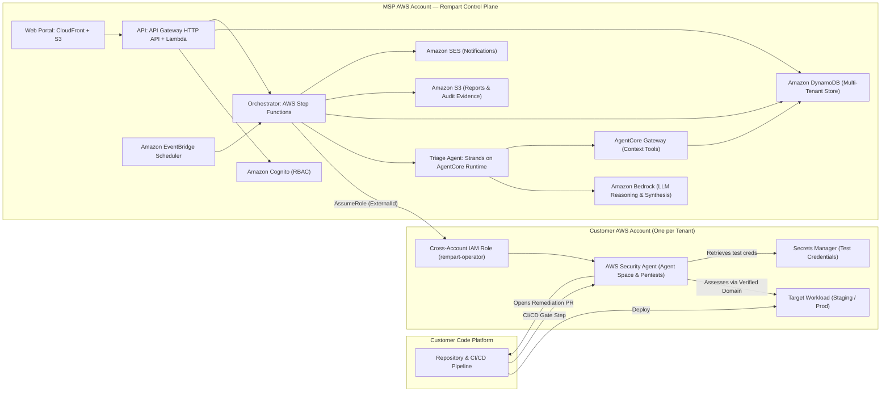
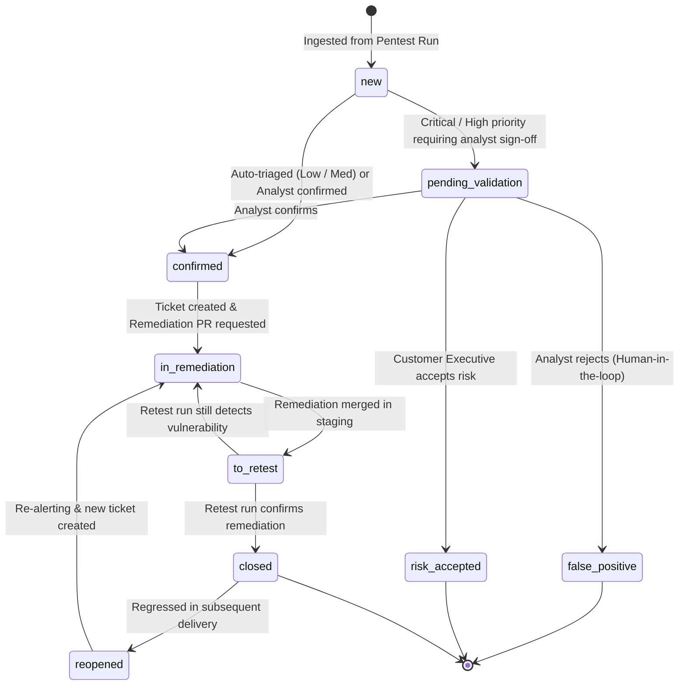

# Rempart — High-Level Design (HLD)

**Continuous Penetration Testing as a Managed Subscription**  
*AWS MSP AI Hackathon — Track 2: Deliver AI-Driven Outcomes for Customers*  
*Target Special Award: Best AWS Frontier Agents Application (AWS Security Agent)*  
*Version 1.0 — November 2026*

---

## 1. Executive Summary

Small and medium-sized enterprises (SMEs) ship code weekly or daily, yet traditional penetration testing remains an annual snapshot delivered as a static PDF weeks after execution. Vulnerabilities introduced between assessments remain undetected in production, remediation guidance lacks application context, and engineering teams lack dedicated security analysts to validate fixes.

**Rempart** transforms application security into a continuous, managed subscription operated by a Managed Service Provider (MSP):
1. **At every release (CI/CD gate)**: AWS Security Agent autonomously tests deployed increments in staging and halts promotion if severe vulnerabilities appear.
2. **Contextual automated triage**: A specialized Strands triage agent running on AgentCore Runtime backed by Amazon Bedrock qualifies findings against business criticality, Internet exposure, and data classification.
3. **End-to-end remediation lifecycle**: Security Agent generates automated remediation pull requests, and post-merge automated retests verify closure with cryptographic and test run evidence before closing tickets.
4. **Multi-tenant MSP governance**: A centralized serverless control plane provisions client environments via infrastructure as code, enforces signed test mandates and verified domains, and caps task-hour expenditure with automatic cutoff.

---

## 2. Problem Statement

### 2.1 The Customer Dilemma (SME / Mid-Market)
- **Cadence mismatch**: Software releases occur continuously; manual penetration tests happen annually.
- **Latency & cost**: Commissioning a manual pentest takes weeks of lead time and costs $15k–$40k per engagement, yielding reports that are obsolete upon delivery.
- **No closed-loop remediation**: Findings linger in ticket backlogs without automated re-testing; subsequent audits rediscover identical vulnerabilities.
- **Skill shortage**: SMEs lack in-house application security engineers to interpret raw scanner outputs, triage false positives, and prioritize remediation.

### 2.2 The MSP Opportunity
AWS Security Agent (part of AWS Continuum) provides deep frontier agent penetration testing capabilities. However, Security Agent is strictly single-account, manually configured per target, lacks multi-tenant fleet visibility, provides no commercial SLA tracking or business-context triage, and incurs uncapped consumption costs ($50 per task-hour). 

Rempart provides the commercial, governance, and operational packaging that enables an MSP to sell continuous pentesting as a scalable, high-margin monthly subscription.

---

## 3. Solution Overview

Rempart delivers continuous pentesting as a tiered managed subscription (Essentiel, Continu, Critique) combining:
- **Zero-touch onboarding**: A single CloudFormation template deployed in the customer account pairs with the MSP control plane in under 30 minutes.
- **Automated release gating**: A lightweight CI/CD pipeline step discovers incremental code deltas and triggers scoped AWS Security Agent runs.
- **Automated triage & guardrails**: AI synthesizes concise summaries and maps CWE/OWASP references, while deterministic code guardrails re-enforce severity matrices and prevent autonomous closure of severe issues.
- **Continuous retesting & proof**: Findings transition from `confirmed` to `in_remediation` to `closed` only when verified by an automated retest run.
- **Executive & audit reporting**: Deterministic monthly metric rollups paired with Bedrock executive summaries provide audit-ready evidence for ISO 27001 and SOC 2.

---

## 4. Architecture

### 4.1 System Architecture



### 4.2 End-to-End Delivery Sequence

```mermaid
sequenceDiagram
  autonumber
  participant Dev as Client Developer
  participant CI as CI/CD Pipeline
  participant SA as Security Agent (Client Account)
  participant Orc as Rempart Step Functions
  participant Tri as Strands Triage Agent
  participant An as MSP Security Analyst
  participant Store as DynamoDB Store

  Dev->>CI: Git push / PR merge
  CI->>CI: Deploy build to staging
  CI->>SA: Trigger CI/CD Gate test (scoped to commit range)
  SA-->>CI: Gate verdict; block promotion if blocking threshold breached
  Orc->>SA: Polls completed pentest job via AssumeRole
  Orc->>Store: Ingest findings & update task-hour budget
  Orc->>Tri: Dispatch findings + Application business context
  Tri->>Tri: Delimited finding analysis & CWE mapping
  Tri-->>Orc: Triage proposal (P1–P4, summaries, duplicate/regression flags)
  Orc->>Orc: Deterministic Guardrail Check (override invalid priority)
  alt Critical or High Severity & False Positive proposed
    Orc->>An: Enqueue to Triage Queue (pending_validation)
    An->>Orc: Analyst confirms or overrides proposal
  end
  Orc->>Dev: Create tracking ticket with SLA countdown
  Orc->>SA: Request automated code remediation PR
  SA-->>Dev: Submits pull request on repository
  Dev->>CI: Review, approve, and merge remediation PR
  CI->>SA: Trigger retest pentest job
  Orc->>SA: Poll retest results
  alt Vulnerability absent in retest
    Orc->>Store: Transition finding to closed with test run proof
    Orc->>Dev: Close ticket with verification proof attached
  else Vulnerability persists
    Orc->>Store: Transition finding back to in_remediation
  end
```

### 4.3 Finding Lifecycle



---

## 5. Architectural Decision: Security Agent in Customer Accounts

Two topologies were evaluated: hosting Security Agent centrally in the MSP account vs. deploying Security Agent in each customer AWS account and managing it remotely.

Rempart selects **Security Agent in each customer account** based on strict AWS service limits and operational requirements:

| Dimension | Centralized MSP Account | Distributed Customer Account (Rempart) | Rationale |
|---|---|---|---|
| **Repository Integrations** | Max 20 per account / region (hard limit, non-adjustable) | 20 per customer account | A centralized model caps the MSP at 20 total repositories across all clients. Distributed scales infinitely. |
| **Security Requirements** | Defined at account level; applied globally to all Agent Spaces | Isolated per customer account | Centralized forces identical organizational security rules across competing tenants. |
| **Concurrent Pentests** | 5 concurrent jobs per account / region default quota | 5 concurrent jobs per customer account | Avoids noisy-neighbor queue starvation across the MSP fleet. |
| **Billing & CloudTrail Isolation** | All task-hours billed to MSP; logs co-mingled | Task-hours natively logged to customer bill; dedicated CloudTrail | Clean liability separation, native customer cost allocation, and audit compliance. |
| **Credential Security** | Target staging credentials stored in MSP account | Target credentials stay inside customer Secrets Manager | Eliminates credential exfiltration risk; follows AWS Shared Responsibility for MSPs. |

Cross-account orchestration uses `sts:AssumeRole` with a tenant-unique `ExternalId` and short-lived credentials.

---

## 6. Data Model

Rempart uses Amazon DynamoDB with a single-table/partition design per entity type. All entities implement deterministic JSON serialization (`to_item()` / `from_item()`):

- **Tenant**: `tenant_id`, `name`, `aws_account_id`, `region`, `role_arn`, `external_id`, `plan` (`essentiel`, `continu`, `critique`), `contacts`, `monthly_budget_hours`, `mandate_status` (`none`, `pending`, `valid`, `expired`), `created_at`.
- **Application**: `app_id`, `tenant_id`, `name`, `criticality` (`low`, `medium`, `high`), `internet_exposed` (bool), `data_types` (`personal`, `payment`, `health`, `none`), `environment` (`staging`, `production`), `agent_space_id`, `domains`, `repositories`, `team`, `ticket_channel`, `context`, `created_at`.
- **TestConfig**: `config_id`, `app_id`, `sa_pentest_id`, `kind` (`delivery`, `full`, `on_demand`), `scope`, `risk_types`, `blocking_threshold`, `schedule`.
- **Run**: `run_id`, `config_id`, `app_id`, `tenant_id`, `trigger` (`cicd`, `schedule`, `manual`, `retest`), `commit_from`, `commit_to`, `scope_decision`, `status` (`queued`, `running`, `completed`, `failed`, `stopped`, `blocked`), `started_at`, `ended_at`, `duration_s`, `task_hours`, `cost_usd`.
- **Finding**: `finding_id`, `app_id`, `tenant_id`, `run_id`, `fingerprint`, `title`, `risk_type`, `severity`, `confidence`, `priority` (`P1`–`P4`), `status` (`new`, `pending_validation`, `confirmed`, `false_positive`, `risk_accepted`, `in_remediation`, `to_retest`, `closed`, `reopened`), `due_at`, `ticket_url`, `remediation_pr_url`, `evidence`, `cvss`, `created_at`, `updated_at`, `closed_at`, `closed_by_run_id`.
- **Decision**: `decision_id`, `finding_id`, `author_type` (`agent`, `human`), `author`, `action`, `justification`, `created_at`.
- **Report**: `report_id`, `tenant_id`, `period` (`YYYY-MM`), `s3_key`, `kpis`, `created_at`.
- **BudgetState**: `tenant_id`, `month` (`YYYY-MM`), `hours_used`, `thresholds_hit`, `auto_stop`.
- **AuditEvent**: `audit_id`, `actor`, `action`, `object_type`, `object_id`, `result`, `created_at`.

### Finding Deduplication & Fingerprinting
Findings are assigned a deterministic SHA-256 fingerprint:
$$\text{fingerprint} = \text{SHA256}(\text{app\_id} \parallel \text{risk\_type} \parallel \text{entry\_point} \parallel \text{parameter})[0:16]$$
If an active finding shares the fingerprint, it is recognized as a duplicate and does not spawn new tickets. If a finding with that fingerprint was previously `closed`, it is immediately flagged as a `reopened` regression.

---

## 7. Multi-Tenancy & Security Architecture

### 7.1 Cross-Account IAM & ExternalId
The control plane assumes the `rempart-operator` role in customer accounts. Confused deputy attacks are prevented by enforcing `sts:ExternalId`:
```json
{
  "Version": "2012-10-17",
  "Statement": [{
    "Effect": "Allow",
    "Principal": { "AWS": "arn:aws:iam::<MSP_ACCOUNT_ID>:role/rempart-orchestrator" },
    "Action": "sts:AssumeRole",
    "Condition": { "StringEquals": { "sts:ExternalId": "<TENANT_EXTERNAL_ID>" } }
  }]
}
```

### 7.2 Strict Multi-Tenant Isolation
- **Role-Based Access Control (Cognito)**: User tokens map to roles (`platform_admin`, `analyst`, `account_manager`, `client_security`, `client_dev`, `executive`, `demo`).
- **Authorization Before Read (ENF-SEC-01)**: Every API route evaluates tenant ownership before query execution. Cross-tenant access attempts return HTTP 403.
- **Demo Mode**: The judge demo account binds to a dedicated read-only tenant (`demo`) with sandboxed, rate-limited on-demand executions.

### 7.3 Compliance & Verified Target Domains
- **Test Mandate Enforcement (ENF-LEG-01)**: The orchestrator verifies that `Tenant.mandate_status == "valid"` prior to launching any pentest. Missing or expired mandates trigger immediate run cancellation.
- **Domain Verification**: AWS Security Agent rejects domains lacking DNS TXT records or HTTP verification tokens, preventing unauthorized scanning.

---

## 8. AI Layer & Guardrails

Rempart pairs the frontier capabilities of AWS Security Agent with an agentic triage system built on Strands Agents, AgentCore Runtime, and Amazon Bedrock.

### 8.1 Strands Triage Agent
The triage agent executes through AgentCore Runtime with strictly defined tools exposed via AgentCore Gateway:
- `get_application_context`: Retrieves business criticality, internet exposure, and handled data categories.
- `search_known_findings`: Looks up historical findings to detect duplicates or patterns.
- `get_past_decisions`: Ingests past analyst decisions for contextual consistency.
- `submit_triage_proposal`: Emits the structured triage recommendation.

### 8.2 Guardrails & Deterministic Verification

| Vulnerability & Risk | Guardrail Mechanism | Policy Enforcement |
|---|---|---|
| **Math Hallucinations** | Deterministic Code Calculation | **ENF-IA-01**: KPIs, costs, task-hours, and SLA due dates are calculated solely by Python functions. The LLM calculates zero numbers. |
| **Priority Skew** | Priority Matrix Override | Triage priority is calculated deterministically via code matrix. If the agent proposes a different priority, the code matrix overrides and logs a divergence. |
| **False Positive Escalation** | Mandatory Human Validation | **ENF-IA-02**: An agent proposal of `LIKELY_FALSE_POSITIVE` on a Critical or High severity finding is forced to `TO_VERIFY` with `needs_human_validation=True`. It cannot be discarded autonomously. |
| **Prompt Injection via Code** | Delimited Data Isolation | **ENF-IA-03**: Pentest findings, code snippets, and URL endpoints are passed in `<finding>` and `<target>` XML tags. System prompts strictly instruct the agent to treat findings as passive data, never instructions. |

### 8.3 Deterministic Priority & SLA Matrix
Base priority is determined by Security Agent severity and confidence, elevated when the application is Internet-exposed with high criticality, and further promoted by sensitive data handling:

| Severity | Confidence | Exposed & High Criticality | Internal / Standard Criticality | Default SLA |
|---|---|---|---|---|
| **Critical** | High | **P1** | **P1** | 7 calendar days |
| **Critical** | Med / Low | **P1** *(validation required)* | **P2** *(validation required)* | 7d (P1) / 30d (P2) |
| **High** | High | **P1** | **P2** | 7d (P1) / 30d (P2) |
| **High** | Med / Low | **P2** *(validation required)* | **P3** *(validation required)* | 30d (P2) / 90d (P3) |
| **Medium** | High | **P2** | **P3** | 30d (P2) / 90d (P3) |
| **Medium** | Med / Low | **P3** | **P4** | 90d (P3) / Next Release |
| **Low / Info** | Any | **P4** | **P4** | Next Release / Accepted |

*Sensitive data (`personal`, `payment`, or `health`) increments priority by one tier (e.g., P2 $\rightarrow$ P1).*

---

## 9. Budget Control & Cost Guardrails

AWS Security Agent bills at **$50.00 per task-hour**, metered to the second. A task-hour measures active agent execution work. Uncontrolled parallel testing on large scopes can rapidly exhaust budgets.

Rempart implements strict cost governance:
1. **Budget Thresholds**: Per-tenant monthly task-hour budgets trigger automated alerts at 50%, 80%, and 100% consumption.
2. **Automated Stop**: When `hours_used >= monthly_budget_hours`, active runs are stopped via `StopPentestJob` and new runs are rejected at the `budget_gate` Step Functions task.
3. **Pre-Run Cost Baseline**: Historical runs provide baseline estimates; CI/CD gate runs use commit range scoping to minimize task-hours.
4. **Free Tier Protection**: During the 2-month, 400 task-hour/month free tier, Rempart tracks usage against the promotional cap to avoid unexpected billing.

---

## 10. Deployment Model

```
                                  [Git Repository]
                                         │
                   ┌─────────────────────┴─────────────────────┐
                   ▼                                           ▼
       [MSP Control Plane]                         [Customer Account]
       AWS CDK (Python)                            CloudFormation Template
       ├── DynamoDB Tables (KMS encrypted)         ├── rempart-operator IAM Role
       ├── Cognito User Pool & Groups              ├── GitHub Actions OIDC Role
       ├── API Gateway HTTP API + Lambda           ├── CloudWatch Log Groups
       ├── Step Functions Orchestrator             └── AWS Budgets Alerts
       ├── Strands / AgentCore Gateway
       └── S3 + CloudFront Portal
```

- **MSP Control Plane**: Synthesized and deployed via AWS CDK (`iac/control-plane`). Provisioned in under 15 minutes.
- **Customer Onboarding**: Packaged as a single CloudFormation template (`iac/client-account/rempart-client.template.yaml`) requiring only 5 input parameters: `MspAccountId`, `MspOrchestratorRoleName`, `ExternalId`, `GitHubOrg`, and `GitHubRepo`.

---

## 11. Expected Measured Outcomes

Rempart tracks eight operational KPIs directly computed from execution timestamps:

| KPI | Formula / Definition | Baseline (Annual Pentest) | Hackathon Demo Target | Production Target |
|---|---|---|---|---|
| **Release to Result Latency** | Pentest completion time minus deployment time | Weeks | **< 2 hours** (simple API) | **< 4 hours** (90% of releases) |
| **Critical Findings Blocked** | P1/P2 blocked at staging gate / Total P1/P2 detected | 0% (tested post-prod) | **100%** (seeded demo flaw) | **> 80%** |
| **Mean Time to Remediate (MTTR)** | Proven closure timestamp minus detection timestamp | > 120 days | Tracked in real time | **P1: ≤ 7 days, P2: ≤ 30 days** |
| **SLA Compliance Rate** | Findings closed before SLA due date / Total due | Unmeasured (< 30%) | Displayed on dashboard | **> 90%** |
| **Contract Coverage** | Continuous apps under test / Total contracted apps | 0% | **2 / 2 apps (100%)** | **100%** |
| **Analyst Efficiency** | Applications managed per full-time MSP security analyst | ~5 apps/analyst | Demonstrated capability | **> 40 apps/analyst** |
| **Reopen / Regression Rate** | Reopened findings / Total closed findings | Unmeasured | Tracked on fleet view | **< 5%** |
| **Cost Variance** | Actual task-hour billing minus budgeted allocation | Uncontrolled | Exact task-hour tracking | **< 10% budget variance** |
