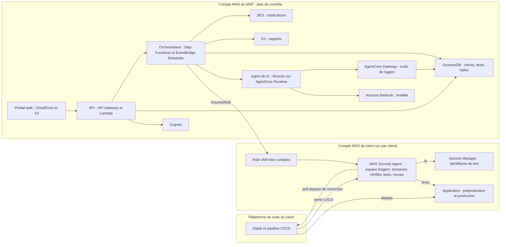
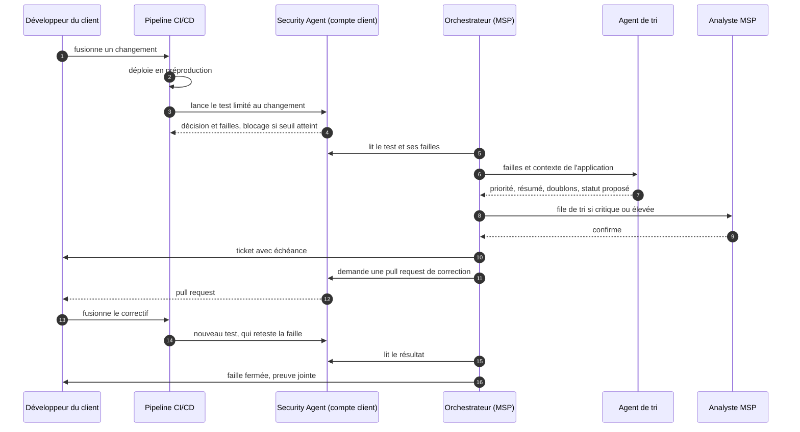
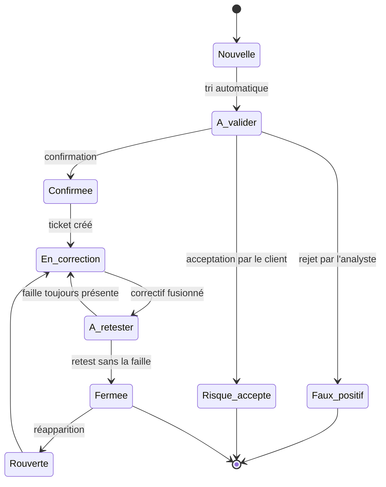

# Cahier des charges — Tests d'intrusion en continu par abonnement

**Nom de travail : Rempart** (à changer librement)
Version 1.0 du 10 novembre 2026 — Hackathon AWS MSP AI, Track 2

> Ce document est en français pour le travail interne. Tous les livrables de la soumission (description, vidéo, schéma d'architecture, document de conception) doivent être en anglais.
>
> Les faits marqués **(vérifié)** ont été lus dans la documentation AWS le 10 novembre 2026 (sources en annexe D). Tout ce qui reste à confirmer est regroupé au chapitre 22.

---

## 1. Fiche d'identité

| Élément | Valeur |
|---|---|
| Track | 2 — Deliver AI-Driven Outcomes for Customers |
| Famille d'exemples visée | Nouvelle offre managée à revenu récurrent |
| Prix spécial visé | Best AWS Frontier Agents Application (Security Agent) |
| Service IA AWS central | AWS Security Agent (« now part of AWS Continuum » dans la documentation) |
| Autres services IA AWS | Amazon Bedrock (modèle de tri et de rédaction), Strands Agents sur AgentCore Runtime (agent de tri), AgentCore Gateway (outils de l'agent) |
| Client final | PME et ETI qui livrent des applications web ou des API |
| Vendeur | Le MSP, sous forme d'abonnement par application |
| Échéance de soumission | Vendredi 11 décembre 2026, 12h00 PT (21h00 à Paris) |
| Fin du jugement | 22 janvier 2027 : la solution doit rester en ligne jusque-là |

## 2. Résumé

Aujourd'hui une PME fait tester la sécurité de son application une fois par an, alors qu'elle livre du code chaque semaine. Entre deux tests, chaque livraison peut ouvrir une faille que personne ne cherche.

Rempart est un service managé vendu par un MSP. À chaque livraison d'une application cliente, AWS Security Agent teste le changement et bloque la mise en production si une faille grave apparaît. Le service du MSP pilote ces tests pour tous ses clients, trie les failles selon le contexte de chaque application, suit leur correction jusqu'à la preuve de fermeture et envoie un rapport mensuel.

La valeur du MSP n'est pas le test lui-même, que Security Agent sait déjà faire. Elle est dans tout ce qui l'entoure : la mise en service automatisée, le pilotage du budget, le tri contextualisé, l'engagement de délai de correction, le suivi jusqu'à la fermeture et le compte rendu au dirigeant.

## 3. Contexte et problème

### 3.1 Le problème du client final

- **Fréquence :** un test d'intrusion manuel est ponctuel, souvent annuel, alors que les livraisons sont hebdomadaires ou quotidiennes.
- **Délai :** il faut plusieurs semaines pour planifier un test manuel et recevoir son rapport.
- **Suite donnée :** le rapport arrive en PDF, personne ne suit les corrections, et le test suivant retrouve les mêmes failles.
- **Compétence :** une PME n'a pas d'équipe sécurité pour lire un rapport technique et décider quoi corriger d'abord.

### 3.2 Ce qu'AWS Security Agent fait déjà (vérifié)

| Capacité | Détail |
|---|---|
| Test d'intrusion à la demande | Sur des domaines dont la propriété est vérifiée (enregistrement DNS TXT, route HTTP ou VPC privé). L'agent reçoit les URL cibles, les identifiants de test, le code source et la documentation comme contexte. |
| Configurations réutilisables | Une configuration se relance autant de fois que voulu. Chaque exécution reteste d'abord les failles de la dernière exécution complète. |
| Planification | Les tests peuvent être planifiés. |
| Porte CI/CD (préversion) | Étape de pipeline après déploiement, pour GitHub Actions, GitLab CI/CD, Bitbucket Pipelines et Azure DevOps. Le périmètre du test est réduit à la plage de commits déployée. Le pipeline est bloqué au-dessus d'un seuil de sévérité. |
| Revue de code | Analyse d'un dépôt complet ou de chaque pull request, avec commentaires dans la pull request. |
| Correctifs | Pull request de correction générée pour une faille de test ou de revue de code. |
| Modèle de menaces | Vue d'ensemble du système et menaces classées selon STRIDE. |
| Revue de conception | Documents d'architecture comparés aux exigences de sécurité de l'organisation. |
| Détail d'une faille | Sévérité (Critical, High, Medium, Low, Informational), confiance de l'agent (High, Medium, Low), type de risque, détail CVSS, étapes de reproduction, script de vérification. |
| Tickets et rapports | Création de tickets Jira, export du rapport de test. |
| API | API complète : `CreateAgentSpace`, `CreateTargetDomain`, `VerifyTargetDomain`, `CreatePentest`, `StartPentestJob`, `BatchGetPentestJobs`, `ListFindings`, `UpdateFinding`, `StartCodeRemediation`, etc. |
| Traçabilité | Appels d'API journalisés dans CloudTrail, métrique CloudWatch `PentestExecutionDuration`. |

### 3.3 Ce qui manque pour en faire un service de MSP

| Manque | Réponse de Rempart |
|---|---|
| Security Agent se configure application par application, à la main | Mise en service automatisée par API et par modèle d'infrastructure |
| Aucune vue sur plusieurs clients | Plan de contrôle central chez le MSP, un déploiement par compte client |
| La facture dépend des heures-tâches, sans plafond | Budget par client et par application, arrêt automatique |
| La sévérité ne tient pas compte du métier du client | Tri par un agent qui connaît la criticité, l'exposition et les données de chaque application |
| Pas d'engagement de délai de correction | Priorités P1 à P4 avec échéance contractuelle et compte à rebours |
| Le suivi s'arrête au ticket | Suivi jusqu'au retest qui prouve la fermeture, réouverture en cas de régression |
| Le rapport est technique | Rapport mensuel lisible par un dirigeant, chiffres à l'appui |

## 4. Objectifs et indicateurs

| Indicateur | Définition | Situation de départ | Cible démo | Cible production |
|---|---|---|---|---|
| Délai livraison → résultat de test | Fin du test moins heure du déploiement | Plusieurs semaines | Moins de 2 h sur une API simple | Moins de 4 h pour 90 % des livraisons |
| Failles graves arrêtées avant la production | Failles P1 et P2 détectées par la porte de préproduction, divisées par toutes les failles P1 et P2 détectées | Non mesuré | Démontré sur une faille semée | Plus de 80 % |
| Délai moyen de correction | Date de fermeture prouvée moins date de détection, par priorité | Non mesuré | Mesuré et affiché | P1 : 7 jours, P2 : 30 jours |
| Respect des échéances | Failles fermées avant leur échéance, divisées par les failles échues | Non mesuré | Affiché | Plus de 90 % |
| Couverture | Applications sous test continu, divisées par les applications du contrat | 0 | 2 applications sur 2 | 100 % |
| Applications par analyste | Applications suivies, divisées par les analystes du MSP | Environ 5 à la main (hypothèse à valider) | Non mesurable | Plus de 40 |
| Taux de réouverture | Failles rouvertes, divisées par les failles fermées | Non mesuré | Affiché | Moins de 5 % |
| Coût d'un test | Heures-tâches multipliées par le tarif | Inconnu | Mesuré par configuration | Écart au budget inférieur à 10 % |

Les indicateurs sont calculés par le code à partir des horodatages enregistrés. Le modèle de langage ne calcule aucun chiffre.

## 5. Périmètre

### 5.1 Inclus dans la version du hackathon

- Deux clients fictifs, chacun dans son propre compte AWS, avec une application de démonstration chacun.
- Mise en service d'une application par API.
- Trois déclencheurs de test : livraison (porte CI/CD), planification mensuelle, demande manuelle.
- Agent de tri, file de validation de l'analyste, tickets dans GitHub Issues.
- Correction par pull request générée, retest, fermeture avec preuve.
- Budget d'heures-tâches avec arrêt automatique.
- Portail web avec vue du parc pour le MSP et vue client.
- Rapport mensuel en HTML et PDF.

### 5.2 Cible après le hackathon

- Tickets Jira, ServiceNow, GitLab ; notifications Slack et Teams.
- Modèle de menaces et revue de conception intégrés au parcours.
- Dossier de preuves pour les audits (ISO 27001, SOC 2).
- Recommandations transverses au parc (« même faille chez trois clients »).
- Export de facturation et place de marché AWS.

### 5.3 Exclu

- Tout test sur un domaine non vérifié ou sans mandat signé.
- Tests de déni de service, ingénierie sociale, intrusion physique.
- Tests du réseau interne et des postes de travail.
- Réponse à incident et surveillance en temps réel (ce n'est pas un SOC).
- Conseil juridique ou certification de conformité.

## 6. Utilisateurs et rôles

| Rôle | Organisation | Ce qu'il fait | Droits |
|---|---|---|---|
| Administrateur de plateforme | MSP | Installe, paramètre, gère les utilisateurs | Tout, tous clients |
| Analyste sécurité | MSP | Valide le tri, qualifie les faux positifs, suit les P1 | Lecture et décision, tous clients |
| Responsable de compte | MSP | Suit les échéances, présente le rapport | Lecture, ses clients |
| Responsable sécurité ou DSI | Client | Lit le tableau de bord, accepte un risque | Lecture, acceptation de risque, son organisation |
| Développeur | Client | Reçoit le ticket, fusionne le correctif | Lecture des failles de ses applications |
| Dirigeant | Client | Lit le rapport mensuel | Rapport seulement |

## 7. Offre de service

### 7.1 Formules (hypothèse de départ, à ajuster)

| | Essentiel | Continu | Critique |
|---|---|---|---|
| Revue de code de chaque pull request | Oui | Oui | Oui |
| Test à chaque livraison (porte CI/CD) | Non | Oui | Oui |
| Test complet planifié | Trimestriel | Mensuel | Mensuel |
| Test à la demande | Non | 1 par mois | Dans la limite du budget |
| Délai de tri d'une faille | 2 jours ouvrés | 1 jour ouvré | 4 heures ouvrées pour une P1 |
| Rapport | Trimestriel | Mensuel | Mensuel, avec réunion |
| Modèle de menaces | À la mise en service | À la mise en service | À chaque évolution majeure |

### 7.2 Logique de prix

- **Abonnement fixe par application :** couvre l'exploitation, le tri, le suivi et le rapport.
- **Budget d'heures-tâches inclus :** fixé par formule. Au-delà, refacturation au coût plus une marge, après accord du client.
- **Mise en service :** forfait unique par application.

### 7.3 Base de coût (vérifié)

- Test d'intrusion : **50 $ par heure-tâche**, compté à la seconde. Une heure-tâche mesure le travail de l'agent, pas la durée d'attente : plusieurs tâches en parallèle consomment plus d'heures-tâches que d'heures écoulées.
- Exemples publiés par AWS : test d'une nouvelle API, environ 3,5 heures-tâches, soit 173 $ ; test mensuel d'un site marchand, 24 heures-tâches, soit 1 200 $ ; test complet d'un SaaS complexe, 31 heures-tâches, soit 1 563 $.
- Tests lancés par la porte CI/CD : **sans frais pendant la préversion**. Leur tarif futur est inconnu.
- Revue de code, revue de conception, modèle de menaces : sans frais pendant leur préversion.
- Essai gratuit : 2 mois à partir du premier test, jusqu'à 400 heures-tâches par mois.
- AWS ne fournit pas d'estimation de coût avant un test. La seule référence est l'historique des tests de la même configuration.

## 8. Parcours

### 8.1 Mise en service d'une application

1. Le responsable de compte crée le client dans le portail : nom, compte AWS, région, contacts, formule, budget mensuel.
2. Le client signe le mandat de test, qui liste les domaines, les environnements et les dates. Le MSP le dépose dans le portail.
3. Le client déploie le modèle d'infrastructure fourni dans son compte. Ce modèle crée le rôle inter-comptes du MSP, le rôle du pipeline et les journaux.
4. Le portail crée l'espace d'agent de l'application, déclare le domaine cible et affiche l'enregistrement DNS à créer. Si le domaine est géré dans Route 53 dans le même compte, la vérification se fait en un clic côté Security Agent.
5. Le client autorise la connexion à son dépôt de code. C'est une étape humaine.
6. Le portail crée les configurations de test (« livraison » et « complet »), active la revue des pull requests et les correctifs automatiques.
7. Le responsable de compte remplit la fiche de contexte : criticité, exposition à Internet, données traitées, équipe propriétaire, canal de tickets.
8. Un premier test complet sert de référence.

### 8.2 À chaque livraison

1. Le développeur fusionne un changement. Le pipeline le déploie en préproduction.
2. L'étape de porte du pipeline lance un test limité au changement déployé.
3. Trois issues possibles : le changement ne touche pas la surface d'attaque et le pipeline passe ; le changement est testé et passe ; une faille atteint le seuil et la promotion est bloquée.
4. Rempart détecte le test, récupère les failles et les envoie à l'agent de tri.

### 8.3 Tri

1. L'agent de tri écarte les doublons, calcule la priorité, rédige un résumé clair et propose un statut.
2. Les failles critiques ou élevées passent dans la file de l'analyste, qui confirme ou corrige en un clic.
3. Une faille confirmée ouvre un ticket chez le client avec son échéance.

### 8.4 Correction et preuve

1. Rempart demande à Security Agent une pull request de correction et la lie au ticket.
2. Le développeur relit et fusionne.
3. La livraison du correctif déclenche un nouveau test, qui reteste la faille.
4. Si la faille a disparu, elle est fermée avec l'identifiant du test comme preuve. Sinon elle retourne en correction.

### 8.5 Rapport mensuel

1. Le premier jour ouvré du mois, Rempart fige les indicateurs du mois écoulé.
2. Le modèle rédige la synthèse à partir de ces chiffres.
3. Le rapport est déposé dans le portail et son lien est envoyé au client.

## 9. Exigences fonctionnelles

Priorité : **M** indispensable pour la démonstration, **S** souhaitable, **C** cible après le hackathon.

### 9.1 Mise en service

| Réf. | Priorité | Exigence |
|---|---|---|
| EF-ONB-01 | M | Créer un client avec son compte AWS, sa région, ses contacts, sa formule et son budget mensuel d'heures-tâches. |
| EF-ONB-02 | M | Fournir un modèle d'infrastructure pour le compte client : rôle inter-comptes avec identifiant externe, rôle OIDC du pipeline, groupes de journaux. |
| EF-ONB-03 | M | Créer par API l'espace d'agent, déclarer le domaine cible, lancer la vérification et afficher ce que le client doit poser (enregistrement DNS ou fichier). |
| EF-ONB-04 | M | Guider la connexion du dépôt, puis activer le contexte de test, la revue de code et les correctifs automatiques. |
| EF-ONB-05 | M | Créer les configurations de test « livraison » et « complet » : périmètre, exclusions, types de risques, référence au secret des identifiants de test. |
| EF-ONB-06 | M | Enregistrer le mandat de test (fichier, périmètre, dates). Sans mandat valide, aucun test ne part. |
| EF-ONB-07 | M | Tenir la fiche de contexte de l'application : criticité, exposition, données, environnement, équipe, canal de tickets. |
| EF-ONB-08 | S | Lancer un modèle de menaces initial et l'archiver comme référence. |
| EF-ONB-09 | S | Charger le pack d'exigences de sécurité du client. |
| EF-ONB-10 | C | Proposer automatiquement les applications candidates d'un compte. |

### 9.2 Orchestration des tests

| Réf. | Priorité | Exigence |
|---|---|---|
| EF-ORC-01 | M | Détecter en moins de 5 minutes un test lancé par la porte CI/CD du client. |
| EF-ORC-02 | M | Lancer un test à la demande depuis le portail. |
| EF-ORC-03 | M | Planifier le test complet (mensuel par défaut). |
| EF-ORC-04 | M | Suivre un test jusqu'à sa fin et récupérer failles, points d'entrée découverts, durée et heures-tâches. |
| EF-ORC-05 | M | Respecter le quota de tests simultanés du compte client au moyen d'une file d'attente. |
| EF-ORC-06 | M | Arrêter un test à la main, ou automatiquement sur dépassement de budget ou de durée. |
| EF-ORC-07 | S | Recevoir un événement de déploiement pour mesurer le délai livraison → résultat. |
| EF-ORC-08 | S | Définir des fenêtres de test par application. Aucun test complet en production hors fenêtre. |
| EF-ORC-09 | C | Adapter le périmètre au budget restant. |

### 9.3 Tri des failles

| Réf. | Priorité | Exigence |
|---|---|---|
| EF-TRI-01 | M | Écarter les doublons : une faille déjà connue n'ouvre pas de nouveau ticket. |
| EF-TRI-02 | M | Calculer la priorité P1 à P4 par une matrice déterministe (chapitre 12). |
| EF-TRI-03 | M | Rédiger un résumé en trois phrases pour un non-spécialiste, et un résumé technique. |
| EF-TRI-04 | M | Proposer un statut (confirmée, à vérifier, faux positif probable) avec sa justification. |
| EF-TRI-05 | M | Exiger une validation humaine pour écarter une faille critique ou élevée. |
| EF-TRI-06 | M | Détecter une régression : faille fermée qui réapparaît. |
| EF-TRI-07 | S | Rattacher la faille à un référentiel (CWE, OWASP Top 10). |
| EF-TRI-08 | S | Regrouper les failles qui ont la même cause. |
| EF-TRI-09 | S | Mémoriser les décisions de l'analyste par application et les réutiliser. |
| EF-TRI-10 | C | Signaler une faille commune à plusieurs clients. |

### 9.4 Suivi des corrections

| Réf. | Priorité | Exigence |
|---|---|---|
| EF-COR-01 | M | Créer un ticket chez le client avec résumé, preuve, étapes et échéance. |
| EF-COR-02 | M | Calculer l'échéance selon la priorité et le contrat, et afficher le temps restant. |
| EF-COR-03 | M | Déclencher la pull request de correction et la lier à la faille. |
| EF-COR-04 | M | Après fusion, retester et fermer avec la preuve. |
| EF-COR-05 | M | Rouvrir la faille si elle persiste. |
| EF-COR-06 | S | Relancer avant et après l'échéance, puis alerter le responsable de compte. |
| EF-COR-07 | S | Enregistrer une acceptation de risque par un rôle habilité du client, avec date de revue. |
| EF-COR-08 | C | Synchroniser les statuts de ticket dans les deux sens. |

### 9.5 Rapports et portail

| Réf. | Priorité | Exigence |
|---|---|---|
| EF-RAP-01 | M | Tableau de bord client : failles ouvertes par priorité, échéances, tests récents, tendance. |
| EF-RAP-02 | M | Tableau de bord du parc pour le MSP : tous clients, indicateurs du chapitre 4. |
| EF-RAP-03 | M | Rapport mensuel par client en HTML et PDF. Synthèse rédigée par le modèle, chiffres calculés par le code. |
| EF-RAP-04 | S | Dossier de preuves exportable pour un audit. |
| EF-POR-01 | M | Authentification, rôles et cloisonnement par client. |
| EF-POR-02 | M | Pages : parc, client, application, test, faille, file de tri, rapports, budget. |
| EF-POR-03 | M | Compte de démonstration pour les juges : lecture, plus un test à la demande limité. |
| EF-POR-04 | M | Interface en anglais pour la soumission. |

### 9.6 Budget, notifications, administration

| Réf. | Priorité | Exigence |
|---|---|---|
| EF-BUD-01 | M | Budget mensuel d'heures-tâches par client et par application, alertes à 50, 80 et 100 %. |
| EF-BUD-02 | M | Coût estimé d'un test : heures-tâches multipliées par le tarif en vigueur, qui est un paramètre. |
| EF-BUD-03 | M | Arrêt automatique à 100 % du budget, réglable par client. |
| EF-BUD-04 | S | Coût de référence par configuration : moyenne des tests précédents. |
| EF-NOT-01 | M | Notifier par e-mail : faille P1 ou P2 confirmée, livraison bloquée, échéance dépassée, seuil de budget. |
| EF-NOT-02 | S | Résumé hebdomadaire. |
| EF-ADM-01 | M | Paramétrer la matrice de priorité, les délais par priorité, le seuil de blocage et le tarif. |
| EF-ADM-02 | M | Journal d'audit consultable : qui a lancé quoi, quelle décision, quand. |

## 10. Exigences non fonctionnelles

| Réf. | Exigence |
|---|---|
| ENF-SEC-01 | Cloisonnement strict par client, vérifié par des tests d'API négatifs. |
| ENF-SEC-02 | Accès inter-comptes par rôle IAM à moindre privilège, identifiant externe unique par client, sessions courtes. |
| ENF-SEC-03 | Les identifiants de test ne quittent jamais le compte du client. |
| ENF-SEC-04 | Chiffrement au repos (KMS) et en transit (TLS 1.2 ou plus). |
| ENF-SEC-05 | Les détails d'exploitation (étapes, scripts) ne sont visibles que des rôles habilités. |
| ENF-SEC-06 | Journal d'audit non modifiable. |
| ENF-LEG-01 | Aucun test sans mandat valide et sans domaine vérifié. |
| ENF-IA-01 | Les chiffres (indicateurs, coûts, échéances) sont calculés par le code, jamais par le modèle. |
| ENF-IA-02 | Le modèle ne peut pas écarter seul une faille critique ou élevée. |
| ENF-IA-03 | Le contenu des failles, du code et des pages testées est une donnée, jamais une instruction pour l'agent de tri. |
| ENF-PERF-01 | Tri de 50 failles en moins de 5 minutes. Page du portail en moins de 2 secondes. |
| ENF-DISP-01 | Disponibilité du portail de 99,5 % en production. Architecture sans serveur. |
| ENF-OBS-01 | Traces et métriques sur chaque étape, alarmes sur les échecs. |
| ENF-REP-01 | Toute l'infrastructure est décrite en code. Un autre MSP peut installer la solution en suivant le README. Un client s'ajoute avec un seul modèle. |
| ENF-DATA-01 | Conservation de 13 mois par défaut. Suppression sous 30 jours en fin de contrat. |
| ENF-COUT-01 | Coût d'exploitation hors tests inférieur à 50 $ par mois pour 10 applications (à mesurer). |

## 11. Architecture technique

### 11.1 Choix structurant : Security Agent dans le compte de chaque client

Deux modèles étaient possibles : tout centraliser dans le compte du MSP, ou activer Security Agent dans le compte de chaque client et le piloter à distance. Le second est retenu, pour quatre raisons tirées des quotas et du fonctionnement du service **(vérifié)** :

- **Intégrations :** 20 par compte et par région, non ajustable. Un compte central plafonnerait à 20 dépôts d'organisations clientes.
- **Exigences de sécurité :** elles sont définies au niveau du compte et s'appliquent à tous les espaces d'agent. Un compte central imposerait les mêmes exigences à tous les clients.
- **Tests simultanés :** 5 par compte et par région par défaut. Un compte par client donne 5 tests simultanés à chacun.
- **Isolation et facturation :** les failles d'un client restent dans son compte, et le coût des tests apparaît sur sa propre facture.

Ce modèle correspond aussi à la définition AWS d'un service managé : une gestion faite depuis l'environnement AWS du client.

### 11.2 Vue d'ensemble



### 11.3 Composants

| Composant | Service AWS | Rôle |
|---|---|---|
| Portail | CloudFront, S3 | Application web statique |
| API | API Gateway, Lambda | Toutes les opérations du portail |
| Identité | Cognito | Utilisateurs, groupes par client, jetons |
| Orchestrateur | Step Functions, EventBridge Scheduler | Cycle de vie d'un test : contrôle du budget, lancement, suivi, collecte, tri, tickets |
| Agent de tri | Strands Agents sur AgentCore Runtime | Dédoublonnage, résumé, statut proposé |
| Outils de l'agent | AgentCore Gateway, Lambda | Lecture du contexte, recherche de failles similaires, écriture de la proposition |
| Modèle | Amazon Bedrock | Raisonnement de l'agent, rédaction du rapport |
| État | DynamoDB | Clients, applications, tests, failles, décisions, budget |
| Rapports | Lambda, S3 | Génération et stockage |
| Notifications | SES | E-mails |
| Côté client | AWS Security Agent, IAM, Secrets Manager, CloudWatch Logs | Tests, revues, correctifs, identifiants de test, journaux |
| Infrastructure en code | AWS CDK, modèle CloudFormation pour le compte client | Reproductibilité |

### 11.4 Déroulé d'une livraison



### 11.5 Cycle de vie d'une faille



### 11.6 Actions de l'API Security Agent utilisées

Les noms viennent de la référence d'API **(vérifié)**. Leurs paramètres restent à lire.

| Étape | Actions |
|---|---|
| Mise en service | `CreateAgentSpace`, `CreateTargetDomain`, `VerifyTargetDomain`, `CreateIntegration`, `UpdateIntegratedResources`, `CreatePentest`, `UpdatePentest`, `CreateSecurityRequirementPack`, `BatchCreateSecurityRequirements` |
| Lancement et suivi | `StartPentestJob`, `StopPentestJob`, `BatchGetPentestJobs`, `ListPentestJobsForPentest`, `ListPentestJobTasks`, `BatchGetPentestJobTasks` |
| Résultats | `ListFindings`, `BatchGetFindings`, `ListDiscoveredEndpoints`, `BatchExportFindings` |
| Suivi des failles | `UpdateFinding`, `StartCodeRemediation` |
| Revue de code | `CreateCodeReview`, `StartCodeReviewJob`, `BatchGetCodeReviewJobs` |
| Modèle de menaces | `CreateThreatModel`, `StartThreatModelJob`, `ListThreats` |

### 11.7 Déclencheurs

| Déclencheur | Mécanisme | Remarque |
|---|---|---|
| Livraison | Étape de porte native de Security Agent dans le pipeline du client | Préversion. Le périmètre est calculé par Security Agent à partir de la plage de commits. Rempart découvre le test par interrogation périodique. |
| Planification | EventBridge Scheduler dans le compte du MSP, puis `StartPentestJob` | Test complet. |
| Demande | Bouton du portail, puis `StartPentestJob` | Soumis au budget. |

## 12. Agent de tri

### 12.1 Principe

L'agent ne remplace pas Security Agent, il travaille sur ses résultats. La priorité est calculée par une matrice. Le modèle sert à ce qu'une règle fixe ne sait pas faire : reconnaître deux failles identiques décrites différemment, expliquer simplement, relier une faille au contexte métier.

### 12.2 Matrice de priorité

| Sévérité Security Agent | Confiance | Application exposée et critique | Autre application |
|---|---|---|---|
| Critical | High | P1 | P1 |
| Critical | Medium ou Low | P1, à vérifier | P2, à vérifier |
| High | High | P1 | P2 |
| High | Medium ou Low | P2, à vérifier | P3, à vérifier |
| Medium | High | P2 | P3 |
| Medium | Medium ou Low | P3 | P4 |
| Low ou Informational | Toutes | P4 | P4 |

Une application qui traite des données personnelles ou de paiement monte d'un cran, sans dépasser P1. La matrice et les délais sont des paramètres par contrat.

| Priorité | Délai de correction par défaut |
|---|---|
| P1 | 7 jours |
| P2 | 30 jours |
| P3 | 90 jours |
| P4 | Prochaine version, ou risque accepté |

### 12.3 Entrées, outils, sorties

- **Entrées :** les failles du test (titre, type de risque, sévérité, confiance, description, points d'entrée), la fiche de contexte de l'application, les failles déjà connues de l'application, les décisions passées de l'analyste.
- **Outils (par AgentCore Gateway) :** `get_application_context`, `search_known_findings`, `get_finding_detail`, `get_past_decisions`, `submit_triage_proposal`.
- **Sortie :** une proposition par faille, au format de l'annexe B.

### 12.4 Garde-fous

- L'agent n'a aucun outil d'écriture autre que `submit_triage_proposal`. Il ne peut ni fermer une faille ni créer un ticket.
- Une proposition « faux positif » sur une faille critique ou élevée est mise en attente de l'analyste.
- La priorité de la sortie est recalculée par le code. Si elle diffère de la matrice, la matrice l'emporte et l'écart est journalisé.
- Le contenu des failles est passé comme donnée délimitée. L'invite système précise qu'aucune instruction qu'il contient ne doit être suivie.

### 12.5 Mesure de la qualité

- **Jeu de référence :** 40 failles étiquetées à la main (statut et doublons attendus).
- **Cibles :** accord avec l'analyste d'au moins 90 % sur le statut, 95 % sur les doublons, aucun faux positif proposé à tort sur une faille critique.
- **En continu :** chaque correction de l'analyste est enregistrée et sert de cas de test.
- **Outil :** AgentCore Evaluations, avec un évaluateur personnalisé pour la clarté du résumé.

## 13. Modèle de données

| Entité | Champs principaux |
|---|---|
| Client | identifiant, nom, compte AWS, région, ARN du rôle, identifiant externe, formule, contacts, budget mensuel, état du mandat |
| Application | identifiant, client, nom, criticité, exposition, types de données, environnement, espace d'agent, domaines, dépôts, équipe, canal de tickets |
| Configuration de test | identifiant Security Agent, application, type (livraison, complet, demande), périmètre, types de risques, seuil de blocage, planification |
| Test | identifiant du job, configuration, déclencheur, commits de début et de fin, décision de périmètre, état, début, fin, durée, heures-tâches, coût estimé |
| Faille | identifiant, application, test d'origine, empreinte, titre, type de risque, sévérité, confiance, priorité, état, échéance, lien du ticket, lien de la pull request, historique |
| Décision | faille, auteur (agent ou personne), action, justification, date |
| Rapport | client, période, emplacement du fichier, indicateurs figés |
| Budget | client, mois, heures-tâches consommées, seuils franchis |
| Événement d'audit | acteur, action, objet, date, résultat |

L'empreinte d'une faille est calculée sur l'application, le type de risque, le point d'entrée et le paramètre touché.

## 14. API du plan de contrôle

| Méthode et chemin | Objet |
|---|---|
| `POST /v1/tenants`, `GET /v1/tenants`, `GET /v1/tenants/{id}` | Clients |
| `POST /v1/tenants/{id}/applications`, `GET /v1/applications/{id}` | Applications |
| `POST /v1/applications/{id}/onboarding`, `GET /v1/applications/{id}/onboarding` | Mise en service et son avancement |
| `POST /v1/applications/{id}/runs`, `GET /v1/applications/{id}/runs` | Test à la demande, liste des tests |
| `GET /v1/runs/{jobId}`, `POST /v1/runs/{jobId}/stop` | Détail et arrêt d'un test |
| `POST /v1/events/deployment` | Événement de déploiement envoyé par le pipeline |
| `GET /v1/findings`, `GET /v1/findings/{id}` | Failles, avec filtres par client, état et priorité |
| `POST /v1/findings/{id}/decision` | Décision de l'analyste ou acceptation de risque |
| `POST /v1/findings/{id}/remediation` | Demande de pull request de correction |
| `GET /v1/tenants/{id}/kpis`, `GET /v1/fleet/kpis` | Indicateurs |
| `POST /v1/tenants/{id}/reports`, `GET /v1/reports/{id}` | Rapports |
| `GET /v1/tenants/{id}/budget`, `PUT /v1/tenants/{id}/budget` | Budget |

Chaque appel porte un jeton Cognito. L'autorisation vérifie le client du jeton avant toute lecture.

## 15. Sécurité, autorisation et conformité

### 15.1 Autorisation de tester

- Tester un système sans autorisation est un délit (en France, article 323-1 du Code pénal). Le mandat signé est donc une condition bloquante dans le produit, pas une formalité.
- Le mandat liste les domaines, les environnements, les dates, les contacts d'urgence et les exclusions.
- Security Agent ne teste que des domaines vérifiés **(vérifié)**. Rempart ajoute le contrôle du mandat avant chaque lancement.
- Par défaut les tests visent la préproduction. Un test en production exige une fenêtre convenue.
- Si l'application dépend d'un hébergeur ou d'un service tiers, le client vérifie que ses conditions autorisent le test.

### 15.2 Accès du MSP au compte client

- Un rôle d'exploitation à moindre privilège (annexe A), utilisable par le seul plan de contrôle du MSP, avec identifiant externe.
- Un rôle de mise en service distinct, plus large, que le client peut supprimer après l'installation.
- Tous les appels sont visibles du client dans son propre CloudTrail.

### 15.3 Données

- Les failles sont des données sensibles : chiffrées, cloisonnées, conservées 13 mois.
- Les scripts de vérification et les étapes d'exploitation restent dans le compte client. Le plan de contrôle n'en garde que le lien.
- Les contacts des clients sont des données personnelles. Le MSP agit comme sous-traitant au sens du RGPD. Le plan de contrôle est hébergé dans une région européenne.

## 16. Coûts et budget

### 16.1 Pour le hackathon

| Poste | Estimation | Remarque |
|---|---|---|
| Tests d'intrusion | 0 $ pendant l'essai | 2 mois, 400 heures-tâches par mois **(vérifié)** |
| Tests lancés par la porte CI/CD | 0 $ | Sans frais pendant la préversion **(vérifié)** |
| Revue de code, modèle de menaces | 0 $ | Sans frais pendant la préversion **(vérifié)** |
| Plan de contrôle sans serveur | Quelques dollars par mois | Lambda, DynamoDB, CloudFront, Step Functions à faible volume |
| Agent de tri | Quelques dollars | AgentCore Runtime facturé à l'usage, plus les jetons du modèle |
| Applications de démonstration | 10 à 30 $ par mois | Deux petites applications en préproduction |
| Nom de domaine | Environ 15 $ par an | Nécessaire pour la vérification des domaines |

### 16.2 Calendrier de l'essai gratuit

- L'essai dure 2 mois à partir du premier test.
- Le jugement se termine le 22 janvier 2027. Pour que l'essai couvre cette date, **le premier test des comptes de démonstration ne doit pas partir avant le 23 novembre 2026**.
- D'ici là, le développement se fait dans un autre compte, si l'essai est bien accordé par compte (à confirmer).
- Les 200 $ de crédits du hackathon expirent le 31 décembre 2026. En janvier, tout ce qui n'est pas couvert par l'essai est à ta charge.

### 16.3 Protections

- Périmètre étroit : quelques chemins d'URL, peu de types de risques.
- Arrêt automatique par Rempart au-delà d'un nombre d'heures-tâches par test.
- Alerte AWS Budgets dans chaque compte.
- Le test à la demande du compte de démonstration des juges est limité à un par jour, sur le périmètre minimal.

## 17. Plan de démonstration

### 17.1 Environnement

- **Trois comptes AWS :** le MSP, le client A, le client B.
- **Deux applications de démonstration écrites pour l'occasion**, une par client, avec des failles semées volontairement : accès aux commandes d'un autre utilisateur, injection SQL dans la recherche, route d'administration sans contrôle d'accès.
- **Pourquoi des applications maison :** le résultat est prévisible, le périmètre est petit donc peu coûteux, et la vidéo ne montre aucune marque tierce.
- **Dépôts privés** connectés à Security Agent, avec la porte dans le pipeline.

### 17.2 Vidéo de 3 minutes

| Temps | Contenu |
|---|---|
| 0:00 à 0:20 | Le problème : un test par an face à une livraison par semaine. La promesse. |
| 0:20 à 0:50 | Mise en service d'une application depuis le portail. On montre l'espace d'agent créé et le domaine vérifié dans le compte du client. |
| 0:50 à 1:30 | Un développeur fusionne un changement qui introduit une faille. Le pipeline déploie, la porte lance le test, la promotion est bloquée. |
| 1:30 à 2:10 | Portail du MSP : résumé clair, priorité P1, échéance, ticket. L'analyste valide. La pull request de correction arrive, elle est fusionnée, le retest ferme la faille. |
| 2:10 à 2:40 | Vue du parc sur deux clients, indicateurs, rapport mensuel généré. |
| 2:40 à 3:00 | Schéma d'architecture, résultats mesurés, ajout d'un client par un seul modèle. |

Un test dure de l'ordre d'une heure : les séquences sont enregistrées à l'avance et montées, avec les horodatages réels à l'écran. La vidéo doit montrer les comptes internes et les environnements en amont et en aval : console du compte client, console du compte MSP, dépôt et pipeline.

## 18. Livrables du hackathon et critères de jugement

### 18.1 Liste de contrôle de la soumission

- [ ] Track 2 sélectionné, service IA AWS indiqué.
- [ ] Description en anglais : fonctions, problème, résultats mesurés.
- [ ] URL publique du portail, avec identifiants de démonstration dans les instructions de test.
- [ ] Dépôt privé partagé avec `testing@devpost.com` et `aws-msp@amazon.com`, contenant code, ressources et instructions.
- [ ] Le code appelle réellement un service IA AWS à l'exécution.
- [ ] Vidéo d'environ 3 minutes, publique sur YouTube, en anglais, sans marque ni musique tierce.
- [ ] Schéma d'architecture.
- [ ] Document de conception (HLD).
- [ ] Si le projet reprend un existant : ce qui a changé pendant la période.

### 18.2 Réponse aux quatre critères (25 % chacun)

| Critère | Ce que le projet montre |
|---|---|
| Mise en œuvre technique | Security Agent est indispensable : sans lui, pas de test. Deux couches de la pile IA d'AWS sont reliées : un agent Frontier (application) et Bedrock avec AgentCore et Strands (outils pour modèles et agents). |
| Conception | Multi-clients, un compte par client, infrastructure en code, ajout d'un client par un modèle, budget et garde-fous. |
| Impact | Trois chiffres mesurés dans la démonstration : délai livraison → résultat, failles arrêtées avant la production, délai de correction. |
| Innovation | Le test d'intrusion devient un abonnement avec engagement de délai et preuve de fermeture, au lieu d'un rapport annuel. |

## 19. Planning

| Semaine | Dates | Travaux | Résultat attendu |
|---|---|---|---|
| S1 | 10 au 15 novembre | Comptes AWS, nom de domaine, demande de crédits, région, applications de démonstration, lecture de la référence d'API, premier test manuel dans le compte de développement | Un test lancé à la main et ses failles lues par API |
| S2 | 16 au 22 novembre | Modèle du compte client, mise en service par API, orchestrateur, stockage des tests et des failles | Un test lancé et suivi par l'orchestrateur |
| S3 | 23 au 29 novembre | Premier test dans les comptes de démonstration (début de l'essai), agent de tri, matrice, tickets, portail (parc, application, file de tri) | Une faille triée et un ticket créé de bout en bout |
| S4 | 30 novembre au 6 décembre | Porte CI/CD, correction et retest, échéances, budget, rapport mensuel, schéma et HLD en anglais | Parcours complet d'une livraison |
| S5 | 7 au 11 décembre | Recette, tournage, description, instructions de test, partage du dépôt | Soumission le 10 décembre au soir, un jour de marge |

## 20. Risques

| Risque | Probabilité | Impact | Parade |
|---|---|---|---|
| Security Agent indisponible dans la région voulue | Moyenne | Fort | Vérifier en S1. Le plan de contrôle peut être dans une autre région que les tests. |
| La porte CI/CD en préversion change ou se comporte mal | Moyenne | Moyen | Repli : l'orchestrateur lance `StartPentestJob` sur un événement de déploiement. |
| Un test coûte plus que prévu après l'essai | Moyenne | Fort | Périmètre étroit, arrêt automatique, alertes de budget, test des juges limité. |
| L'essai gratuit ne couvre pas tout le jugement | Moyenne | Moyen | Premier test des comptes de démonstration à partir du 23 novembre. |
| Résultats de test variables d'une exécution à l'autre | Moyenne | Moyen | Failles semées simples, plusieurs répétitions, séquences enregistrées. |
| Le projet passe pour une simple surcouche | Moyenne | Fort | Montrer ce que Security Agent ne fait pas : multi-clients, budget, tri contextualisé, échéances, preuve de fermeture, rapport. |
| Noms d'actions d'API différents selon les pages de la documentation | Faible | Faible | Se fier à la référence d'API, tester chaque appel en S1. |
| Fuite de données entre clients | Faible | Très fort | Tests négatifs automatisés, un compte par client pour les failles. |
| Retard sur le planning | Moyenne | Fort | Les exigences S et C sont sacrifiables. Le parcours M prime. |

## 21. Recette

| Réf. | Scénario | Résultat attendu |
|---|---|---|
| R1 | Mise en service d'une application | Terminée en moins de 30 minutes, dont moins de 10 minutes d'actions humaines |
| R2 | Livraison contenant une faille semée | Résultat en moins de 2 heures, promotion bloquée |
| R3 | Livraison sans effet sur la surface d'attaque | Pipeline non bloqué, décision tracée |
| R4 | Fin d'un test avec failles | Priorité, résumé, échéance et ticket en moins de 5 minutes |
| R5 | L'agent propose « faux positif » sur une faille élevée | Mise en attente de l'analyste, aucun changement d'état |
| R6 | Correction par pull request | Fusion, retest, fermeture avec l'identifiant du test |
| R7 | Faille réintroduite | Rouverte et marquée comme régression |
| R8 | Budget dépassé pendant un test | Test arrêté, alerte envoyée |
| R9 | Utilisateur du client A sur les données du client B | Refus sur chaque point d'API |
| R10 | Rapport mensuel | Chiffres identiques au tableau de bord |
| R11 | Installation dans un compte vierge | Réussie en suivant le README |
| R12 | Lancement d'un test sans mandat valide | Refusé |

## 22. Points à confirmer

| N° | Question | Quand |
|---|---|---|
| 1 | Dans quelles régions AWS Security Agent est-il disponible ? | S1 |
| 2 | L'essai gratuit est-il accordé par compte ou par organisation ? | S1 |
| 3 | Paramètres exacts des actions d'API. La documentation cite `StartPentestJob` et, ailleurs, `StartPentestExecution` ; une page décrit une migration des noms d'actions IAM. | S1 |
| 4 | Le mode CI/CD d'une configuration s'active-t-il par API ou seulement par la console ? | S1 |
| 5 | Les heures-tâches d'un test sont-elles lisibles par API pendant son exécution ? | S1 |
| 6 | Existe-t-il un événement de fin de test (EventBridge) ou faut-il interroger périodiquement ? | S2 |
| 7 | Quel sera le tarif des tests continus après la préversion ? | Avant de fixer les prix |
| 8 | La connexion d'un dépôt peut-elle se faire sans étape humaine ? | S2 |
| 9 | Ton organisation est-elle inscrite à l'AWS Partner Network ? | Avant tout |
| 10 | Quel nom employer dans la soumission : « AWS Security Agent » ou « AWS Continuum » ? | S5 |
| 11 | Les hypothèses commerciales (formules, applications par analyste) | Après le hackathon |

## 23. Glossaire

| Terme | Sens |
|---|---|
| Heure-tâche | Unité de facturation de Security Agent : une heure de travail de l'agent, toutes tâches parallèles cumulées. |
| Espace d'agent | Conteneur Security Agent qui représente une application ou un projet. |
| Domaine vérifié | Domaine dont la propriété a été prouvée ; seul un domaine vérifié peut être testé. |
| Porte CI/CD | Étape de pipeline qui teste après un déploiement et bloque la promotion si besoin. |
| Mandat de test | Autorisation écrite du client de tester ses systèmes. |
| Plan de contrôle | Partie de Rempart hébergée chez le MSP, qui pilote tous les clients. |
| P1 à P4 | Priorités de correction de Rempart, de la plus urgente à la moins urgente. |
| HLD | Document de conception de haut niveau exigé par le hackathon. |

---

## Annexe A — Politique IAM du rôle d'exploitation (compte client)

Les six premières actions figurent dans la documentation de la porte CI/CD. Les autres reprennent les noms de la référence d'API ; leur forme IAM est à valider.

```json
{
  "Version": "2012-10-17",
  "Statement": [
    {
      "Sid": "PilotageDesTests",
      "Effect": "Allow",
      "Action": [
        "securityagent:StartPentestJob",
        "securityagent:StopPentestJob",
        "securityagent:BatchGetPentestJobs",
        "securityagent:ListFindings",
        "securityagent:BatchGetFindings",
        "securityagent:ListIntegratedResources",
        "securityagent:ListPentestJobsForPentest",
        "securityagent:ListPentestJobTasks",
        "securityagent:BatchGetPentestJobTasks",
        "securityagent:ListPentests",
        "securityagent:BatchGetPentests",
        "securityagent:ListDiscoveredEndpoints",
        "securityagent:UpdateFinding",
        "securityagent:StartCodeRemediation",
        "securityagent:ListAgentSpaces",
        "securityagent:BatchGetAgentSpaces"
      ],
      "Resource": "*"
    }
  ]
}
```

Politique de confiance du même rôle :

```json
{
  "Version": "2012-10-17",
  "Statement": [
    {
      "Effect": "Allow",
      "Principal": { "AWS": "arn:aws:iam::<compte-msp>:role/rempart-orchestrator" },
      "Action": "sts:AssumeRole",
      "Condition": { "StringEquals": { "sts:ExternalId": "<identifiant-unique-du-client>" } }
    }
  ]
}
```

## Annexe B — Proposition de tri pour une faille

```json
{
  "findingId": "f-0123",
  "duplicateOf": null,
  "isRegression": false,
  "proposedStatus": "CONFIRMED",
  "priority": "P1",
  "plainSummary": "Un client connecté peut lire les commandes d'un autre client en changeant un numéro dans l'adresse. Les noms, adresses et achats de tous les clients sont exposés. Il faut vérifier que la commande appartient bien à l'utilisateur connecté.",
  "technicalSummary": "Contrôle d'accès manquant sur GET /orders/{id} : l'identifiant n'est pas comparé à l'utilisateur de la session.",
  "references": ["CWE-639", "OWASP A01"],
  "justification": "Sévérité High, confiance High, application exposée à Internet, données personnelles.",
  "needsHumanValidation": true
}
```

## Annexe C — Trame du rapport mensuel

1. Synthèse pour le dirigeant : niveau de risque du mois, trois faits marquants, une décision attendue.
2. Indicateurs : délai livraison → résultat, failles ouvertes et fermées, respect des échéances, couverture.
3. Nouvelles failles, par priorité.
4. Failles corrigées, avec leur preuve.
5. Failles en retard, avec responsable et nouvelle date.
6. Tests réalisés : nombre, type, livraisons bloquées.
7. Budget : heures-tâches consommées et restantes.
8. Recommandations du mois.
9. Annexe technique : détail par application.

## Annexe D — Sources consultées le 10 novembre 2026

- Hackathon : `https://aws-agentic-msp.devpost.com/` (pages d'accueil, ressources, FAQ, règlement)
- AWS Security Agent, guide d'utilisation : `https://docs.aws.amazon.com/securityagent/latest/userguide/` (présentation, fonctionnement, hiérarchie des ressources, tarification, porte CI/CD, vérification des domaines, revue des failles, quotas, journalisation)
- AWS Security Agent, référence d'API : `https://docs.aws.amazon.com/securityagent/latest/APIReference/API_Operations.html`
- AWS Security Agent, tarifs : `https://aws.amazon.com/security-agent/pricing/`
- Amazon Bedrock AgentCore, guide du développeur : `https://docs.aws.amazon.com/bedrock-agentcore/latest/devguide/`
- Amazon Bedrock AgentCore, tarifs : `https://aws.amazon.com/bedrock/agentcore/pricing/`
